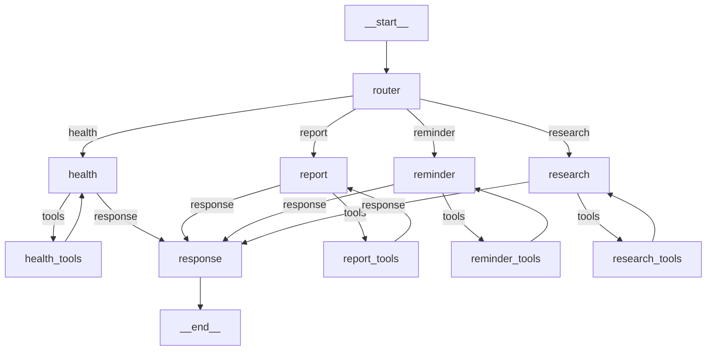
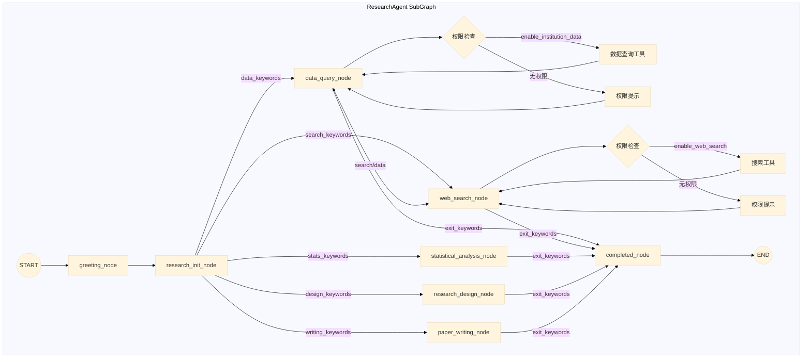

# EyeAgent LangGraph 升级方案

> 版本: 1.1
> 日期: 2025-12-16
> 状态: 待评审

---

## 目录

1. [执行摘要](#1-执行摘要)
2. [当前架构分析](#2-当前架构分析)
3. [LangGraph目标架构](#3-langgraph目标架构)
4. [依赖升级](#4-依赖升级)
5. [核心组件迁移](#5-核心组件迁移)
6. [详细迁移步骤](#6-详细迁移步骤)
7. [代码实现示例](#7-代码实现示例)
8. [迁移对照表](#8-迁移对照表)
9. [风险评估与缓解](#9-风险评估与缓解)
10. [测试策略](#10-测试策略)
11. [回滚计划](#11-回滚计划)
12. [数据迁移策略（P0）](#12-数据迁移策略p0)
13. [ResearchAgent子图设计](#13-researchagent子图设计)
14. [工具调用状态回写](#14-工具调用状态回写)
15. [异步并发优化](#15-异步并发优化)
16. [MySQL Checkpoint存储](#16-mysql-checkpoint存储)
17. [附录](#附录)

---

## 1. 执行摘要

### 1.1 升级目标

将现有基于 LangChain Agent 的多Agent医疗咨询系统迁移至 LangGraph 框架，以获得：

- **更清晰的流程控制**：图结构可视化工作流
- **原生状态管理**：替代手动会话管理
- **断点续传能力**：内置 Checkpoint 机制
- **更好的可观测性**：执行轨迹跟踪
- **Human-in-the-loop**：原生支持人工审核节点

### 1.2 升级范围

| 组件 | 影响程度 | 说明 |
|------|----------|------|
| BaseAgent | **重写** | 核心框架变更 |
| 4个业务Agent | **重写** | 转为Graph节点 |
| AgentManager | **重写** | 改为图管理器 |
| SessionManager | **移除** | 由Checkpoint替代 |
| ConversationManager | **简化** | 状态由Graph管理 |
| HybridIntentRouter | **保留** | 作为路由节点 |
| 工具定义 | **复用** | @tool装饰器兼容 |
| 持久化服务 | **适配** | 对接Checkpoint |
| API路由 | **适配** | 接口参数调整 |

### 1.3 预估工作量

| 阶段 | 工作项 | 说明 |
|------|--------|------|
| 阶段1 | 依赖升级 + 基础框架 | 建立LangGraph基础设施 |
| 阶段2 | 核心Agent迁移 | 迁移4个业务Agent |
| 阶段3 | 路由与状态管理 | 整合意图路由和Checkpoint |
| 阶段4 | API适配与测试 | 端到端测试和修复 |
| 阶段5 | 清理与优化 | 移除冗余代码 |

---

## 2. 当前架构分析

### 2.1 系统架构图

```
┌─────────────────────────────────────────────────────────────────┐
│                        Presentation Layer                        │
│  ┌──────────────┐  ┌──────────────┐  ┌──────────────────────┐  │
│  │ chat_router  │  │research_router│  │ conversation_router │  │
│  └──────┬───────┘  └──────┬───────┘  └──────────┬───────────┘  │
└─────────┼─────────────────┼─────────────────────┼───────────────┘
          │                 │                     │
          ▼                 ▼                     ▼
┌─────────────────────────────────────────────────────────────────┐
│                         Agent Layer                              │
│  ┌─────────────────────────────────────────────────────────┐   │
│  │                    AgentManager                          │   │
│  │  ┌─────────────┐ ┌─────────────┐ ┌─────────────────┐   │   │
│  │  │SessionManager│ │HybridRouter │ │ID Mapping Service│   │   │
│  │  └─────────────┘ └─────────────┘ └─────────────────┘   │   │
│  └─────────────────────────────────────────────────────────┘   │
│                              │                                   │
│  ┌───────────────────────────┼───────────────────────────────┐  │
│  │                      BaseAgent                             │  │
│  │  ┌──────────────────┐  ┌──────────────────────────────┐  │  │
│  │  │ConversationManager│  │LangChain AgentExecutor       │  │  │
│  │  │  - history[]      │  │  - STRUCTURED_CHAT_REACT     │  │  │
│  │  │  - stage          │  │  - tools[]                   │  │  │
│  │  │  - metadata       │  │  - prefix prompt             │  │  │
│  │  └──────────────────┘  └──────────────────────────────┘  │  │
│  └───────────────────────────────────────────────────────────┘  │
│                              │                                   │
│  ┌──────────┐ ┌──────────┐ ┌──────────┐ ┌──────────────────┐   │
│  │HealthAgent│ │ReportAgent│ │ReminderAgent│ │ResearchAgent │   │
│  │ - tools  │ │ - tools  │ │ - tools  │ │ - tools        │   │
│  │ - prompt │ │ - prompt │ │ - prompt │ │ - permissions  │   │
│  └──────────┘ └──────────┘ └──────────┘ └──────────────────┘   │
└─────────────────────────────────────────────────────────────────┘
```

### 2.2 关键组件分析

#### 2.2.1 BaseAgent (`agents/base/base_agent.py`)

**当前职责**：
- 初始化LLM和工具
- 创建AgentExecutor (STRUCTURED_CHAT_ZERO_SHOT_REACT_DESCRIPTION)
- 管理对话历史（ConversationManager）
- 处理阶段转换逻辑
- 支持流式输出（astream_events）

**核心方法**：
```python
def chat(self, user_input: str) -> str
async def chat_stream(self, user_input: str) -> AsyncGenerator
def _create_agent_executor(self)
def _build_additional_context(self)
```

**问题**：
- 状态管理与执行逻辑耦合
- 阶段转换逻辑分散在各子类
- 缺乏执行轨迹可视化

#### 2.2.2 AgentManager (`agents/agent_manager.py`)

**当前职责**：
- Agent实例的创建/获取/删除
- 依赖SessionManager管理会话
- Agent类型切换（switch_agent_type）

**问题**：
- Agent实例在内存中，无法跨进程恢复
- 与SessionManager紧耦合

#### 2.2.3 SessionManager (`infrastructure/session/session_manager.py`)

**当前职责**：
- 内存存储会话数据
- 会话过期管理
- TTL控制（默认30分钟）

**问题**：
- 纯内存存储，重启丢失
- 无法分布式部署
- 与Checkpoint功能重复

#### 2.2.4 HybridIntentRouter (`utils/hybrid_intent_router.py`)

**当前职责**：
- 规则引擎快速匹配（90%流量）
- LLM语义分析（10%流量）
- 结果融合决策

**优势**：
- 设计良好，可复用
- 与Agent解耦

#### 2.2.5 对话阶段枚举 (`domain/enums/conversation_stage.py`)

**当前实现**：
- 26个对话阶段（跨4个Agent）
- 阶段转换逻辑在各Agent的 `_handle_stage_transition()` 中

---

## 3. LangGraph目标架构

### 3.1 架构设计图

```
┌─────────────────────────────────────────────────────────────────┐
│                        Presentation Layer                        │
│  ┌──────────────┐  ┌──────────────┐  ┌──────────────────────┐  │
│  │ chat_router  │  │research_router│  │ conversation_router │  │
│  └──────┬───────┘  └──────┬───────┘  └──────────┬───────────┘  │
└─────────┼─────────────────┼─────────────────────┼───────────────┘
          │                 │                     │
          ▼                 ▼                     ▼
┌─────────────────────────────────────────────────────────────────┐
│                     LangGraph Layer                              │
│                                                                  │
│  ┌────────────────────────────────────────────────────────────┐ │
│  │                   MedicalAgentGraph                        │ │
│  │                                                            │ │
│  │   ┌─────────┐                                              │ │
│  │   │  START  │                                              │ │
│  │   └────┬────┘                                              │ │
│  │        │                                                   │ │
│  │        ▼                                                   │ │
│  │   ┌─────────────┐    ┌────────────────────────────────┐   │ │
│  │   │ RouterNode  │───▶│    Conditional Edge            │   │ │
│  │   │(HybridRouter)│   │  route_by_intent()             │   │ │
│  │   └─────────────┘    └─────┬──────┬──────┬──────┬─────┘   │ │
│  │                            │      │      │      │          │ │
│  │           ┌────────────────┘      │      │      └────────┐ │ │
│  │           ▼                       ▼      ▼               ▼ │ │
│  │   ┌──────────────┐   ┌──────────────┐ ┌──────────────┐ ┌──────────────┐│
│  │   │HealthAgent   │   │ ReportAgent  │ │ReminderAgent │ │ResearchAgent ││
│  │   │    Node      │   │    Node      │ │    Node      │ │    Node      ││
│  │   │  ┌────────┐  │   │  ┌────────┐  │ │  ┌────────┐  │ │  ┌────────┐  ││
│  │   │  │ Tools  │  │   │  │ Tools  │  │ │  │ Tools  │  │ │  │ Tools  │  ││
│  │   │  └────────┘  │   │  └────────┘  │ │  └────────┘  │ │  └────────┘  ││
│  │   └──────┬───────┘   └──────┬───────┘ └──────┬───────┘ └──────┬───────┘│
│  │          │                  │                │                │         │
│  │          └────────┬─────────┴────────┬───────┴────────────────┘         │
│  │                   ▼                  ▼                                  │
│  │            ┌──────────────┐   ┌──────────────┐                         │
│  │            │  ResponseNode│   │   END        │                         │
│  │            │  (后处理)    │──▶│              │                         │
│  │            └──────────────┘   └──────────────┘                         │
│  └────────────────────────────────────────────────────────────────────────┘│
│                                                                            │
│  ┌────────────────────────────────────────────────────────────────────────┐│
│  │                        State Management                                ││
│  │  ┌─────────────────┐  ┌───────────────────────────────────┐           ││
│  │  │ MedicalState    │  │ CheckpointSaver                   │           ││
│  │  │ - messages[]    │  │ (SQLite/PostgreSQL/Redis)         │           ││
│  │  │ - patient_info  │  │ - 持久化状态                      │           ││
│  │  │ - stage         │  │ - 断点续传                        │           ││
│  │  │ - agent_type    │  │ - 跨进程恢复                      │           ││
│  │  │ - metadata      │  │                                   │           ││
│  │  └─────────────────┘  └───────────────────────────────────┘           ││
│  └────────────────────────────────────────────────────────────────────────┘│
└────────────────────────────────────────────────────────────────────────────┘
```

### 3.2 核心设计原则

1. **单一图，多节点**：一个 `MedicalAgentGraph` 包含所有Agent节点
2. **状态驱动**：所有信息通过 `MedicalState` 传递
3. **条件路由**：使用 `HybridIntentRouter` 作为路由决策
4. **工具节点化**：工具调用作为独立节点
5. **Checkpoint持久化**：替代SessionManager

### 3.3 状态设计

```python
from typing import TypedDict, List, Optional, Annotated
from langchain_core.messages import BaseMessage
from langgraph.graph import add_messages

class MedicalState(TypedDict):
    """医疗Agent系统状态"""
    # === 消息历史 ===
    messages: Annotated[List[BaseMessage], add_messages]

    # === 用户上下文 ===
    patient_id: str
    doctor_id: Optional[str]
    role: str  # "patient" | "doctor"

    # === 患者数据 ===
    patient_info: Optional[dict]
    patient_full_data: Optional[dict]

    # === 对话状态 ===
    current_agent: str  # "health" | "report" | "reminder" | "research"
    stage: str
    is_completed: bool

    # === 路由决策 ===
    route_result: Optional[dict]
    should_switch_agent: bool

    # === Agent特有数据 ===
    # HealthAgent
    needs_appointment: bool
    collected_fields: List[str]
    chief_complaint: str
    present_illness: str

    # ResearchAgent
    enable_institution_data: bool
    enable_web_search: bool
    web_search_types: List[str]
    search_history: List[str]

    # === 会话元数据 ===
    session_id: str
    conversation_id: Optional[str]

    # === 错误处理 ===
    error: Optional[str]
```

---

## 4. 依赖升级

### 4.1 当前依赖

```txt
# requirements.txt (当前)
langchain==0.1.0
langchain-openai==0.0.2
```

### 4.2 目标依赖

```txt
# requirements.txt (升级后)
langchain>=0.2.16
langchain-core>=0.2.38
langchain-openai>=0.1.25
langgraph>=0.2.45
langgraph-checkpoint>=2.0.0
langgraph-checkpoint-sqlite>=2.0.0  # 或 langgraph-checkpoint-postgres
```

### 4.3 升级步骤

```bash
# 1. 备份当前环境
pip freeze > requirements_backup.txt

# 2. 创建新虚拟环境（推荐）
python -m venv venv_langgraph
source venv_langgraph/bin/activate  # Linux/Mac
# or: venv_langgraph\Scripts\activate  # Windows

# 3. 安装新依赖
pip install langchain>=0.2.16
pip install langchain-openai>=0.1.25
pip install langgraph>=0.2.45
pip install langgraph-checkpoint-sqlite>=2.0.0

# 4. 验证安装
python -c "import langgraph; print(langgraph.__version__)"
```

### 4.4 API变更注意事项

| LangChain 0.1 | LangChain 0.2+ | 说明 |
|---------------|----------------|------|
| `initialize_agent()` | 已废弃 | 使用 `create_react_agent()` 或 LangGraph |
| `AgentExecutor` | 仍可用但推荐迁移 | LangGraph提供更好的控制 |
| `ConversationBufferMemory` | 已废弃 | 使用消息列表 |
| `astream_events(version="v1")` | `astream_events(version="v2")` | API版本更新 |

---

## 5. 核心组件迁移

### 5.1 目录结构变更

```
agents/
├── base/
│   ├── base_agent.py          # 删除（功能迁移到图节点）
│   └── conversation_manager.py # 简化（仅保留历史格式化）
├── graph/                      # 新增：LangGraph核心
│   ├── __init__.py
│   ├── state.py               # MedicalState定义
│   ├── graph_builder.py       # 图构建器
│   ├── nodes/                 # 图节点
│   │   ├── __init__.py
│   │   ├── router_node.py     # 意图路由节点
│   │   ├── health_node.py     # 健康咨询节点
│   │   ├── report_node.py     # 报告节点
│   │   ├── reminder_node.py   # 提醒节点
│   │   ├── research_node.py   # 科研节点
│   │   └── response_node.py   # 响应后处理节点
│   ├── edges/                 # 条件边
│   │   ├── __init__.py
│   │   └── routing.py         # 路由决策函数
│   └── checkpointer.py        # Checkpoint配置
├── health/
│   └── health_agent.py        # 删除（迁移到nodes/health_node.py）
├── report/
│   └── report_agent.py        # 删除
├── reminder/
│   └── reminder_agent.py      # 删除
├── research/
│   └── research_agent.py      # 删除
├── tools/                      # 保留：工具定义无需改动
│   ├── agent_tools.py
│   └── research_tools.py
├── agent_manager.py           # 重写为GraphManager
└── prompts/                    # 新增：集中管理提示词
    ├── __init__.py
    ├── health_prompts.py
    ├── report_prompts.py
    ├── reminder_prompts.py
    └── research_prompts.py
```

### 5.2 组件映射关系

| 原组件 | 新组件 | 迁移策略 |
|--------|--------|----------|
| `BaseAgent` | `graph/nodes/*.py` | 拆分为独立节点函数 |
| `BaseAgent._create_system_prompt()` | `prompts/*.py` | 提取为独立模块 |
| `BaseAgent._handle_stage_transition()` | `edges/routing.py` | 转为条件边函数 |
| `BaseAgent.chat()` | `graph.invoke()` | 图调用替代 |
| `BaseAgent.chat_stream()` | `graph.astream()` | 流式图调用 |
| `HealthAgent` | `nodes/health_node.py` | 逻辑迁移 |
| `ReportAgent` | `nodes/report_node.py` | 逻辑迁移 |
| `ReminderAgent` | `nodes/reminder_node.py` | 逻辑迁移 |
| `ResearchAgent` | `nodes/research_node.py` | 逻辑迁移 |
| `AgentManager` | `GraphManager` | 重写 |
| `SessionManager` | `CheckpointSaver` | 替换 |
| `ConversationManager` | 内置于State | 简化 |
| `HybridIntentRouter` | `nodes/router_node.py` | 包装为节点 |

---

## 6. 详细迁移步骤

### 阶段1：基础设施搭建

#### 步骤1.1：创建State定义

**文件**: `agents/graph/state.py`

```python
"""
MedicalState - LangGraph状态定义
"""
from typing import TypedDict, List, Optional, Annotated, Any
from langchain_core.messages import BaseMessage
from langgraph.graph import add_messages


class MedicalState(TypedDict):
    """
    医疗Agent系统的全局状态

    设计原则：
    1. 消息使用add_messages reducer自动合并
    2. 其他字段使用覆盖更新
    3. 保持与原Conversation模型兼容
    """
    # ========== 消息历史 ==========
    messages: Annotated[List[BaseMessage], add_messages]

    # ========== 用户身份 ==========
    patient_id: str
    doctor_id: Optional[str]
    role: str  # "patient" | "doctor"
    session_id: str
    conversation_id: Optional[str]

    # ========== 患者数据缓存 ==========
    patient_info: Optional[dict]
    patient_full_data: Optional[dict]

    # ========== 对话状态 ==========
    current_agent: str  # "health" | "report" | "reminder" | "research"
    stage: str
    is_completed: bool

    # ========== 路由相关 ==========
    route_result: Optional[dict]
    should_switch_agent: bool

    # ========== HealthAgent特有 ==========
    needs_appointment: bool
    collected_fields: List[str]
    chief_complaint: str
    present_illness: str
    appointment_confirmed: bool

    # ========== ResearchAgent特有 ==========
    enable_institution_data: bool
    enable_web_search: bool
    web_search_types: List[str]
    search_history: List[str]

    # ========== 响应 ==========
    response: str
    error: Optional[str]


def create_initial_state(
    patient_id: str,
    session_id: str,
    role: str = "patient",
    doctor_id: Optional[str] = None,
    agent_type: str = "health",
    conversation_id: Optional[str] = None,
    **kwargs
) -> MedicalState:
    """创建初始状态"""
    return MedicalState(
        messages=[],
        patient_id=patient_id,
        doctor_id=doctor_id,
        role=role,
        session_id=session_id,
        conversation_id=conversation_id,
        patient_info=None,
        patient_full_data=None,
        current_agent=agent_type,
        stage="greeting",
        is_completed=False,
        route_result=None,
        should_switch_agent=False,
        needs_appointment=False,
        collected_fields=[],
        chief_complaint="",
        present_illness="",
        appointment_confirmed=False,
        enable_institution_data=kwargs.get("enable_institution_data", False),
        enable_web_search=kwargs.get("enable_web_search", False),
        web_search_types=kwargs.get("web_search_types", []),
        search_history=[],
        response="",
        error=None,
    )
```

#### 步骤1.2：创建Checkpoint配置

**文件**: `agents/graph/checkpointer.py`

```python
"""
Checkpoint配置 - 状态持久化
"""
import os
from typing import Optional
from langgraph.checkpoint.sqlite import SqliteSaver
# from langgraph.checkpoint.postgres import PostgresSaver  # 生产环境推荐

# SQLite存储路径
CHECKPOINT_DB_PATH = os.getenv("CHECKPOINT_DB_PATH", "./data/checkpoints.db")


def get_checkpointer() -> SqliteSaver:
    """
    获取Checkpoint保存器

    开发环境：SQLite
    生产环境：建议切换为PostgreSQL或Redis
    """
    # 确保目录存在
    os.makedirs(os.path.dirname(CHECKPOINT_DB_PATH), exist_ok=True)

    return SqliteSaver.from_conn_string(CHECKPOINT_DB_PATH)


def get_thread_config(session_id: str, conversation_id: Optional[str] = None):
    """
    获取线程配置

    LangGraph使用thread_id来区分不同的对话
    """
    # 使用conversation_id或session_id作为thread_id
    thread_id = conversation_id or session_id
    return {"configurable": {"thread_id": thread_id}}
```

### 阶段2：节点实现

#### 步骤2.1：路由节点

**文件**: `agents/graph/nodes/router_node.py`

```python
"""
RouterNode - 意图路由节点
复用现有的HybridIntentRouter
"""
from typing import Dict, Any
from agents.graph.state import MedicalState
from utils.hybrid_intent_router import get_hybrid_router
import logging

logger = logging.getLogger(__name__)


def router_node(state: MedicalState) -> Dict[str, Any]:
    """
    路由节点：分析用户意图，决定使用哪个Agent

    Args:
        state: 当前状态

    Returns:
        更新的状态字段
    """
    # 获取最后一条用户消息
    messages = state.get("messages", [])
    if not messages:
        return {"route_result": None, "should_switch_agent": False}

    last_message = messages[-1]
    if last_message.type != "human":
        return {"route_result": None, "should_switch_agent": False}

    user_input = last_message.content
    current_agent = state.get("current_agent", "health")
    role = state.get("role", "patient")

    # 使用现有的HybridIntentRouter
    router = get_hybrid_router()

    # 构建对话历史（用于上下文分析）
    conversation_history = [
        {"role": msg.type, "content": msg.content}
        for msg in messages[:-1]  # 排除最新消息
    ]

    route_result = router.route(
        message=user_input,
        role=role,
        conversation_history=conversation_history,
        current_agent=current_agent,
        current_stage=state.get("stage")
    )

    # 判断是否需要切换Agent
    should_switch = router.should_switch_agent(
        current_agent=current_agent,
        detected_intent=route_result,
        threshold=0.7
    )

    logger.info(
        f"[RouterNode] 路由决策: {user_input[:30]}... -> "
        f"{route_result.get('agent_type')} (置信度: {route_result.get('confidence', 0):.2f})"
    )

    return {
        "route_result": route_result,
        "should_switch_agent": should_switch,
        "current_agent": route_result.get("agent_type") if should_switch else current_agent
    }
```

#### 步骤2.2：HealthAgent节点

**文件**: `agents/graph/nodes/health_node.py`

```python
"""
HealthAgent节点 - 健康咨询、分诊、预约
"""
from typing import Dict, Any
from langchain_core.messages import AIMessage, HumanMessage, SystemMessage
from langgraph.prebuilt import ToolNode
from agents.graph.state import MedicalState
from agents.tools.agent_tools import AGENT_1_TOOLS
from agents.prompts.health_prompts import (
    get_health_system_prompt,
    get_health_stage_prompt,
    build_health_context
)
from utils.llm_config import get_llm
import logging

logger = logging.getLogger(__name__)


def health_agent_node(state: MedicalState) -> Dict[str, Any]:
    """
    健康咨询Agent节点

    职责：
    - 健康咨询和症状评估
    - 眼科分诊问诊
    - 预约医生
    """
    messages = state.get("messages", [])
    role = state.get("role", "patient")
    stage = state.get("stage", "greeting")

    # 构建系统提示词
    system_prompt = get_health_system_prompt(role)
    stage_prompt = get_health_stage_prompt(stage, role)
    context = build_health_context(state)

    # 构建完整提示
    full_system_prompt = f"""{system_prompt}

【当前阶段】{stage_prompt}

{context}
"""

    # 获取LLM
    llm = get_llm()

    # 绑定工具
    llm_with_tools = llm.bind_tools(AGENT_1_TOOLS)

    # 构建消息列表
    llm_messages = [SystemMessage(content=full_system_prompt)] + messages

    # 调用LLM
    response = llm_with_tools.invoke(llm_messages)

    # 提取信息并更新状态
    updates = extract_health_info(state, messages[-1].content if messages else "")

    # 处理阶段转换
    new_stage = handle_health_stage_transition(
        state,
        messages[-1].content if messages else "",
        response.content
    )

    return {
        "messages": [response],
        "stage": new_stage,
        "response": response.content,
        **updates
    }


def extract_health_info(state: MedicalState, user_input: str) -> Dict[str, Any]:
    """从用户输入提取健康信息"""
    updates = {}
    collected_fields = list(state.get("collected_fields", []))

    # 症状关键词检测
    symptom_keywords = {
        "视力问题": ["模糊", "看不清", "视力下降"],
        "眼痛": ["疼", "痛", "刺痛"],
        "眼红": ["红", "充血"],
    }

    for symptom_type, keywords in symptom_keywords.items():
        if any(kw in user_input for kw in keywords):
            if "chief_complaint" not in collected_fields:
                collected_fields.append("chief_complaint")
                updates["chief_complaint"] = user_input
            break

    # 时间描述检测（现病史）
    time_keywords = ["今天", "昨天", "最近", "一周", "几天"]
    if any(kw in user_input for kw in time_keywords):
        if "present_illness" not in collected_fields:
            collected_fields.append("present_illness")
            current = state.get("present_illness", "")
            updates["present_illness"] = f"{current}；{user_input}" if current else user_input

    # 预约意图检测
    appointment_keywords = ["预约", "挂号", "看医生", "就诊"]
    if any(kw in user_input for kw in appointment_keywords):
        updates["needs_appointment"] = True

    updates["collected_fields"] = collected_fields
    return updates


def handle_health_stage_transition(
    state: MedicalState,
    user_input: str,
    ai_response: str
) -> str:
    """处理阶段转换"""
    current_stage = state.get("stage", "greeting")
    needs_appointment = state.get("needs_appointment", False)
    user_lower = user_input.lower()

    # 阶段转换逻辑（与原HealthAgent一致）
    if current_stage == "greeting":
        if len(user_input) > 10:
            return "health_consultation"

    elif current_stage == "health_consultation":
        return "symptom_assessment"

    elif current_stage == "symptom_assessment":
        eye_keywords = ["眼", "视力", "模糊", "疼"]
        if any(kw in user_input for kw in eye_keywords):
            return "appointment_inquiry"

    elif current_stage == "appointment_inquiry":
        positive_keywords = ["是", "好", "要", "需要", "可以"]
        if any(kw in user_lower for kw in positive_keywords):
            return "patient_info_collection"

    # 检测预约意图的快速转换
    if needs_appointment and current_stage not in ["appointment_booking", "completed"]:
        return "patient_info_collection"

    return current_stage


# 工具执行节点
health_tools_node = ToolNode(tools=AGENT_1_TOOLS)
```

#### 步骤2.3：其他Agent节点（简化示例）

**文件**: `agents/graph/nodes/report_node.py`

```python
"""
ReportAgent节点 - 病历报告和历史分析
"""
from typing import Dict, Any
from langchain_core.messages import SystemMessage
from langgraph.prebuilt import ToolNode
from agents.graph.state import MedicalState
from agents.tools.agent_tools import AGENT_2_TOOLS
from agents.prompts.report_prompts import get_report_system_prompt
from utils.llm_config import get_llm
import logging

logger = logging.getLogger(__name__)


def report_agent_node(state: MedicalState) -> Dict[str, Any]:
    """报告Agent节点"""
    messages = state.get("messages", [])
    role = state.get("role", "patient")

    system_prompt = get_report_system_prompt(role)
    llm = get_llm()
    llm_with_tools = llm.bind_tools(AGENT_2_TOOLS)

    llm_messages = [SystemMessage(content=system_prompt)] + messages
    response = llm_with_tools.invoke(llm_messages)

    return {
        "messages": [response],
        "response": response.content
    }


report_tools_node = ToolNode(tools=AGENT_2_TOOLS)
```

### 阶段3：图构建

#### 步骤3.1：主图构建器

**文件**: `agents/graph/graph_builder.py`

```python
"""
MedicalAgentGraph - 医疗Agent系统主图
"""
from typing import Literal
from langgraph.graph import StateGraph, START, END
from langgraph.prebuilt import ToolNode

from agents.graph.state import MedicalState
from agents.graph.nodes.router_node import router_node
from agents.graph.nodes.health_node import health_agent_node, health_tools_node
from agents.graph.nodes.report_node import report_agent_node, report_tools_node
from agents.graph.nodes.reminder_node import reminder_agent_node, reminder_tools_node
from agents.graph.nodes.research_node import research_agent_node, research_tools_node
from agents.graph.checkpointer import get_checkpointer


def route_by_agent_type(state: MedicalState) -> Literal["health", "report", "reminder", "research"]:
    """根据当前Agent类型路由"""
    return state.get("current_agent", "health")


def should_use_tools(state: MedicalState) -> Literal["tools", "response"]:
    """判断是否需要执行工具"""
    messages = state.get("messages", [])
    if not messages:
        return "response"

    last_message = messages[-1]

    # 检查是否有工具调用
    if hasattr(last_message, "tool_calls") and last_message.tool_calls:
        return "tools"

    return "response"


def get_tools_node_for_agent(state: MedicalState) -> str:
    """获取对应Agent的工具节点名称"""
    agent_type = state.get("current_agent", "health")
    return f"{agent_type}_tools"


def response_node(state: MedicalState) -> dict:
    """响应后处理节点"""
    # 可以在这里添加响应后处理逻辑
    # 例如：持久化、日志记录等
    return {}


def build_medical_graph() -> StateGraph:
    """
    构建医疗Agent系统图

    图结构：
    START -> router -> agent_node -> tools? -> response -> END
    """
    # 创建图
    graph = StateGraph(MedicalState)

    # ========== 添加节点 ==========

    # 路由节点
    graph.add_node("router", router_node)

    # Agent节点
    graph.add_node("health", health_agent_node)
    graph.add_node("report", report_agent_node)
    graph.add_node("reminder", reminder_agent_node)
    graph.add_node("research", research_agent_node)

    # 工具节点
    graph.add_node("health_tools", health_tools_node)
    graph.add_node("report_tools", report_tools_node)
    graph.add_node("reminder_tools", reminder_tools_node)
    graph.add_node("research_tools", research_tools_node)

    # 响应节点
    graph.add_node("response", response_node)

    # ========== 添加边 ==========

    # START -> router
    graph.add_edge(START, "router")

    # router -> agent (条件边)
    graph.add_conditional_edges(
        "router",
        route_by_agent_type,
        {
            "health": "health",
            "report": "report",
            "reminder": "reminder",
            "research": "research",
        }
    )

    # 每个Agent -> 工具判断
    for agent in ["health", "report", "reminder", "research"]:
        graph.add_conditional_edges(
            agent,
            should_use_tools,
            {
                "tools": f"{agent}_tools",
                "response": "response",
            }
        )
        # 工具执行后返回Agent
        graph.add_edge(f"{agent}_tools", agent)

    # response -> END
    graph.add_edge("response", END)

    return graph


def compile_medical_graph(with_checkpointer: bool = True):
    """
    编译医疗Agent图

    Args:
        with_checkpointer: 是否启用Checkpoint（状态持久化）
    """
    graph = build_medical_graph()

    if with_checkpointer:
        checkpointer = get_checkpointer()
        return graph.compile(checkpointer=checkpointer)

    return graph.compile()


# 全局编译图实例
_compiled_graph = None


def get_medical_graph(with_checkpointer: bool = True):
    """获取编译后的图（单例）"""
    global _compiled_graph
    if _compiled_graph is None:
        _compiled_graph = compile_medical_graph(with_checkpointer)
    return _compiled_graph
```

### 阶段4：GraphManager实现

**文件**: `agents/graph_manager.py`

```python
"""
GraphManager - 替代原AgentManager
管理图的调用和状态
"""
from typing import Optional, Dict, Any, AsyncGenerator
import logging
import uuid

from langchain_core.messages import HumanMessage

from agents.graph.state import MedicalState, create_initial_state
from agents.graph.graph_builder import get_medical_graph
from agents.graph.checkpointer import get_thread_config
from application.services.chat_persistence_service import ChatPersistenceService

logger = logging.getLogger(__name__)


class GraphManager:
    """
    图管理器

    职责：
    - 管理图的调用
    - 处理状态初始化和恢复
    - 支持同步和流式调用
    """

    def __init__(self):
        self.graph = get_medical_graph(with_checkpointer=True)
        logger.info("[GraphManager] 初始化完成")

    def chat(
        self,
        message: str,
        patient_id: str,
        session_id: Optional[str] = None,
        conversation_id: Optional[str] = None,
        agent_type: str = "health",
        role: str = "patient",
        doctor_id: Optional[str] = None,
        persistence_service: Optional[ChatPersistenceService] = None,
        **kwargs
    ) -> Dict[str, Any]:
        """
        同步对话

        Args:
            message: 用户消息
            patient_id: 患者ID
            session_id: 会话ID
            conversation_id: 数据库会话ID
            agent_type: Agent类型
            role: 用户角色
            doctor_id: 医生ID
            persistence_service: 持久化服务

        Returns:
            响应字典，包含response、stage、is_completed等
        """
        session_id = session_id or f"sess_{uuid.uuid4().hex[:16]}"

        # 获取线程配置（用于Checkpoint）
        config = get_thread_config(session_id, conversation_id)

        # 检查是否有现有状态
        existing_state = None
        try:
            existing_state = self.graph.get_state(config)
        except Exception:
            pass

        if existing_state and existing_state.values:
            # 恢复现有对话
            input_state = {"messages": [HumanMessage(content=message)]}
            logger.info(f"[GraphManager] 继续对话: {session_id}")
        else:
            # 创建新对话
            input_state = create_initial_state(
                patient_id=patient_id,
                session_id=session_id,
                role=role,
                doctor_id=doctor_id,
                agent_type=agent_type,
                conversation_id=conversation_id,
                **kwargs
            )
            input_state["messages"] = [HumanMessage(content=message)]
            logger.info(f"[GraphManager] 新建对话: {session_id}")

        # 调用图
        result = self.graph.invoke(input_state, config)

        # 持久化消息
        if persistence_service and conversation_id:
            try:
                persistence_service.save_message(
                    chat_id=conversation_id,
                    role="user",
                    content=message
                )
                persistence_service.save_message(
                    chat_id=conversation_id,
                    role="assistant",
                    content=result.get("response", "")
                )
            except Exception as e:
                logger.error(f"[GraphManager] 持久化失败: {e}")

        return {
            "response": result.get("response", ""),
            "session_id": session_id,
            "conversation_id": conversation_id,
            "is_completed": result.get("is_completed", False),
            "stage": result.get("stage", "greeting"),
            "agent_type": result.get("current_agent", agent_type),
            "metadata": {
                "patient_id": patient_id,
                "role": role,
                "needs_appointment": result.get("needs_appointment", False),
            }
        }

    async def chat_stream(
        self,
        message: str,
        patient_id: str,
        session_id: Optional[str] = None,
        conversation_id: Optional[str] = None,
        agent_type: str = "health",
        role: str = "patient",
        doctor_id: Optional[str] = None,
        **kwargs
    ) -> AsyncGenerator[Dict[str, Any], None]:
        """
        流式对话

        Yields:
            事件字典：token/tool_start/tool_end/done/error
        """
        session_id = session_id or f"sess_{uuid.uuid4().hex[:16]}"
        config = get_thread_config(session_id, conversation_id)

        # 检查现有状态
        existing_state = None
        try:
            existing_state = self.graph.get_state(config)
        except Exception:
            pass

        if existing_state and existing_state.values:
            input_state = {"messages": [HumanMessage(content=message)]}
        else:
            input_state = create_initial_state(
                patient_id=patient_id,
                session_id=session_id,
                role=role,
                doctor_id=doctor_id,
                agent_type=agent_type,
                conversation_id=conversation_id,
                **kwargs
            )
            input_state["messages"] = [HumanMessage(content=message)]

        full_response = ""

        try:
            async for event in self.graph.astream_events(
                input_state,
                config,
                version="v2"
            ):
                event_type = event.get("event")

                if event_type == "on_chat_model_stream":
                    chunk = event.get("data", {}).get("chunk")
                    if chunk and hasattr(chunk, "content") and chunk.content:
                        content = chunk.content
                        full_response += content
                        yield {"event": "token", "content": content}

                elif event_type == "on_tool_start":
                    yield {
                        "event": "tool_start",
                        "tool": event.get("name", "unknown"),
                        "input": event.get("data", {}).get("input", {})
                    }

                elif event_type == "on_tool_end":
                    yield {
                        "event": "tool_end",
                        "tool": event.get("name", "unknown"),
                        "output": str(event.get("data", {}).get("output", ""))[:500]
                    }

            # 获取最终状态
            final_state = self.graph.get_state(config)

            yield {
                "event": "done",
                "response": full_response,
                "session_id": session_id,
                "conversation_id": conversation_id,
                "is_completed": final_state.values.get("is_completed", False),
                "stage": final_state.values.get("stage", "greeting"),
                "agent_type": final_state.values.get("current_agent", agent_type)
            }

        except Exception as e:
            logger.error(f"[GraphManager] 流式错误: {e}", exc_info=True)
            yield {"event": "error", "message": str(e)}

    def get_conversation_state(
        self,
        session_id: str,
        conversation_id: Optional[str] = None
    ) -> Optional[Dict[str, Any]]:
        """获取会话状态"""
        config = get_thread_config(session_id, conversation_id)
        try:
            state = self.graph.get_state(config)
            if state and state.values:
                return dict(state.values)
        except Exception as e:
            logger.error(f"[GraphManager] 获取状态失败: {e}")
        return None

    def reset_conversation(
        self,
        session_id: str,
        conversation_id: Optional[str] = None
    ) -> bool:
        """重置会话"""
        # LangGraph的Checkpoint不支持直接删除
        # 可以通过创建新的thread_id来实现
        logger.info(f"[GraphManager] 重置会话: {session_id}")
        return True


# 全局单例
_graph_manager = None


def get_graph_manager() -> GraphManager:
    """获取GraphManager单例"""
    global _graph_manager
    if _graph_manager is None:
        _graph_manager = GraphManager()
    return _graph_manager
```

### 阶段5：API适配

#### 步骤5.1：修改chat_router.py

**变更点**：

```python
# 原代码
from agents.agent_manager import AgentManager
agent_manager = AgentManager()

# 新代码
from agents.graph_manager import get_graph_manager
graph_manager = get_graph_manager()

# 原调用
agent = agent_manager.get_or_create_agent(...)
response_text = agent.chat(request.message)

# 新调用
result = graph_manager.chat(
    message=request.message,
    patient_id=request.patient_id,
    session_id=session_id,
    conversation_id=conversation_id,
    agent_type=effective_agent_type,
    role=request.role,
    doctor_id=request.doctor_id,
    persistence_service=persistence_service
)
response_text = result["response"]
```

---

## 7. 代码实现示例

### 7.1 完整的提示词模块

**文件**: `agents/prompts/health_prompts.py`

```python
"""
HealthAgent提示词 - 从原HealthAgent迁移
"""


def get_health_system_prompt(role: str) -> str:
    """获取系统提示词"""
    if role == "doctor":
        return _DOCTOR_MODE_PROMPT
    return _PATIENT_MODE_PROMPT


_PATIENT_MODE_PROMPT = """你叫小Eye，你是一位专业的EyeAgent平台医疗健康咨询助手，专门负责眼科相关的健康咨询和分诊服务。

你的职责：
1. 提供专业的健康咨询建议
2. 评估患者症状的严重程度
3. 在适当的时候主动询问患者是否需要预约医生
4. 进行详细的眼科分诊问诊，收集患者信息
5. 帮助患者完成医生预约

【预约流程 - 必须遵守】
当患者表达预约意愿时，按以下步骤操作：

第一步：从对话历史中整合已知信息
第二步：查询可用时间（调用工具）
第三步：确认预约并完成

【重要提示】
- 语气温和、专业、有同理心
- 绝对不要编造预约时间，必须调用工具查询真实数据
- 不要重复询问患者已经回答过的问题"""


_DOCTOR_MODE_PROMPT = """你叫小Eye，你是一位专业的EyeAgent平台医疗助手，当前正在协助医生分析患者情况。

【重要】当前使用者是医生，不是患者！
- 对话历史中标记为"医生"的是医生的提问和指令
- 你的任务是帮助医生分析患者
- 不要把医生当成患者

你的职责（医生模式）：
1. 协助医生分析患者的健康状况和症状
2. 根据医生要求提供专业的诊断建议和分析
3. 帮助医生查询患者数据
4. 协助医生为患者进行预约操作"""


def get_health_stage_prompt(stage: str, role: str) -> str:
    """获取阶段提示"""
    if role == "doctor":
        prompts = {
            "greeting": "了解医生需要什么帮助",
            "health_consultation": "协助医生分析患者症状",
            "symptom_assessment": "帮助医生评估患者症状严重程度",
            "appointment_inquiry": "询问医生是否需要为患者预约",
            "patient_info_collection": "确认患者信息是否完整",
            "appointment_booking": "协助医生为患者预约",
            "completed": "操作完成"
        }
    else:
        prompts = {
            "greeting": "初次接待，询问患者的健康问题",
            "health_consultation": "正在进行健康咨询，了解患者症状",
            "symptom_assessment": "评估症状严重程度，判断是否需要就医",
            "appointment_inquiry": "询问患者是否需要预约医生",
            "patient_info_collection": "收集患者基本信息",
            "appointment_booking": "确认预约详情，询问期望就诊时间",
            "completed": "预约已完成"
        }
    return prompts.get(stage, "")


def build_health_context(state: dict) -> str:
    """构建上下文"""
    context_parts = []

    role = state.get("role", "patient")
    patient_info = state.get("patient_info")

    if role == "doctor":
        context_parts.append("【当前操作者】身份: 医生")
        if state.get("doctor_id"):
            context_parts.append(f"医生ID: {state['doctor_id']}")

    if patient_info:
        context_parts.append("【患者信息】")
        context_parts.append(f"姓名: {patient_info.get('name', '未知')}")
        context_parts.append(f"年龄: {patient_info.get('age', '未知')}岁")
        if patient_info.get("medical_history"):
            context_parts.append(f"既往病史: {patient_info['medical_history']}")
    else:
        context_parts.append(f"【患者ID】{state.get('patient_id', '未知')}")

    # 已收集信息
    if state.get("chief_complaint"):
        context_parts.append(f"✓ 主诉: {state['chief_complaint']}")
    if state.get("present_illness"):
        context_parts.append(f"✓ 现病史: {state['present_illness']}")

    context_parts.append(f"需要预约: {'是' if state.get('needs_appointment') else '否'}")

    return "\n".join(context_parts)
```

### 7.2 可视化图结构

```python
# 生成图可视化
from agents.graph.graph_builder import build_medical_graph

graph = build_medical_graph()
print(graph.get_graph().draw_mermaid())
```

输出的Mermaid图：



---

## 8. 迁移对照表

### 8.1 类/文件迁移

| 原文件 | 新文件 | 变更类型 |
|--------|--------|----------|
| `agents/base/base_agent.py` | `agents/graph/nodes/*.py` | 拆分 |
| `agents/health/health_agent.py` | `agents/graph/nodes/health_node.py` | 重写 |
| `agents/report/report_agent.py` | `agents/graph/nodes/report_node.py` | 重写 |
| `agents/reminder/reminder_agent.py` | `agents/graph/nodes/reminder_node.py` | 重写 |
| `agents/research/research_agent.py` | `agents/graph/nodes/research_node.py` | 重写 |
| `agents/agent_manager.py` | `agents/graph_manager.py` | 重写 |
| `infrastructure/session/session_manager.py` | 删除 | 由Checkpoint替代 |
| `agents/base/conversation_manager.py` | 简化保留 | 仅保留格式化方法 |
| `utils/hybrid_intent_router.py` | 保留 | 包装为节点 |
| `agents/tools/agent_tools.py` | 保留 | 无改动 |
| `presentation/routers/chat_router.py` | 适配 | 调用方式改变 |

### 8.2 方法迁移

| 原方法 | 新实现 |
|--------|--------|
| `BaseAgent.chat()` | `GraphManager.chat()` -> `graph.invoke()` |
| `BaseAgent.chat_stream()` | `GraphManager.chat_stream()` -> `graph.astream_events()` |
| `BaseAgent._create_system_prompt()` | `prompts/xxx_prompts.py` |
| `BaseAgent._handle_stage_transition()` | `edges/routing.py` + 节点内 |
| `BaseAgent._extract_info_from_input()` | 节点内函数 |
| `AgentManager.get_or_create_agent()` | `GraphManager.chat()` (自动处理) |
| `AgentManager.switch_agent_type()` | 路由节点自动切换 |
| `SessionManager.*` | `CheckpointSaver` (内置) |

### 8.3 状态字段迁移

| 原字段位置 | 新字段位置 |
|------------|------------|
| `Conversation.history` | `MedicalState.messages` |
| `Conversation.stage` | `MedicalState.stage` |
| `Conversation.is_completed` | `MedicalState.is_completed` |
| `BaseAgent.patient_id` | `MedicalState.patient_id` |
| `BaseAgent.patient_info` | `MedicalState.patient_info` |
| `HealthAgent.needs_appointment` | `MedicalState.needs_appointment` |
| `HealthAgent.collected_fields` | `MedicalState.collected_fields` |
| `ResearchAgent.enable_web_search` | `MedicalState.enable_web_search` |

---

## 9. 风险评估与缓解

### 9.1 技术风险

| 风险 | 级别 | 影响 | 缓解措施 |
|------|------|------|----------|
| LangChain大版本升级不兼容 | 高 | 工具定义可能需要调整 | 先在测试环境验证所有工具 |
| Checkpoint存储性能 | 中 | SQLite在高并发下可能瓶颈 | 生产环境使用PostgreSQL |
| 流式响应格式变化 | 中 | 前端可能需要适配 | 保持SSE事件格式一致 |
| 状态序列化问题 | 中 | 复杂对象可能无法序列化 | 使用基本类型，测试序列化 |

### 9.2 业务风险

| 风险 | 级别 | 影响 | 缓解措施 |
|------|------|------|----------|
| 对话历史丢失 | 高 | 用户体验差 | 迁移前导出现有会话 |
| 工具调用行为变化 | 中 | 预约等功能可能异常 | 充分测试工具调用链 |
| 意图识别准确率下降 | 低 | 路由错误 | 保留原HybridRouter逻辑 |

### 9.3 缓解策略

1. **并行运行**：新旧系统并行一段时间
2. **灰度发布**：按用户比例逐步切换
3. **快速回滚**：保留原代码，一键切换

---

## 10. 测试策略

### 10.1 单元测试

```python
# tests/test_graph_nodes.py

import pytest
from agents.graph.state import create_initial_state, MedicalState
from agents.graph.nodes.router_node import router_node
from agents.graph.nodes.health_node import health_agent_node, extract_health_info
from langchain_core.messages import HumanMessage


class TestRouterNode:
    def test_route_to_health(self):
        """测试路由到健康咨询"""
        state = create_initial_state(
            patient_id="test-uuid",
            session_id="test-session",
        )
        state["messages"] = [HumanMessage(content="我眼睛有点疼")]

        result = router_node(state)

        assert result["current_agent"] == "health"
        assert result["route_result"]["confidence"] > 0.5

    def test_route_to_reminder(self):
        """测试路由到提醒管理"""
        state = create_initial_state(
            patient_id="test-uuid",
            session_id="test-session",
        )
        state["messages"] = [HumanMessage(content="帮我设置一个用药提醒")]

        result = router_node(state)

        assert result["current_agent"] == "reminder"


class TestHealthNode:
    def test_extract_symptom(self):
        """测试症状提取"""
        state = create_initial_state(
            patient_id="test-uuid",
            session_id="test-session",
        )

        updates = extract_health_info(state, "我眼睛很疼，看东西模糊")

        assert "chief_complaint" in updates.get("collected_fields", [])
        assert updates.get("chief_complaint") is not None

    def test_detect_appointment_intent(self):
        """测试预约意图检测"""
        state = create_initial_state(
            patient_id="test-uuid",
            session_id="test-session",
        )

        updates = extract_health_info(state, "我想预约医生")

        assert updates.get("needs_appointment") is True
```

### 10.2 集成测试

```python
# tests/test_graph_integration.py

import pytest
from agents.graph.graph_builder import compile_medical_graph
from agents.graph.state import create_initial_state
from langchain_core.messages import HumanMessage


class TestGraphIntegration:
    @pytest.fixture
    def graph(self):
        """创建测试图（不使用Checkpoint）"""
        return compile_medical_graph(with_checkpointer=False)

    def test_full_health_conversation(self, graph):
        """测试完整的健康咨询对话"""
        state = create_initial_state(
            patient_id="test-uuid",
            session_id="test-session",
        )
        state["messages"] = [HumanMessage(content="你好，我眼睛最近不太舒服")]

        result = graph.invoke(state)

        assert result["response"] is not None
        assert len(result["response"]) > 0
        assert result["current_agent"] == "health"

    def test_agent_switch(self, graph):
        """测试Agent切换"""
        state = create_initial_state(
            patient_id="test-uuid",
            session_id="test-session",
            agent_type="health",
        )
        state["messages"] = [HumanMessage(content="帮我查看我的提醒")]

        result = graph.invoke(state)

        # 应该自动切换到reminder
        assert result["current_agent"] == "reminder"


class TestStreamingIntegration:
    @pytest.fixture
    def graph(self):
        return compile_medical_graph(with_checkpointer=False)

    @pytest.mark.asyncio
    async def test_streaming_response(self, graph):
        """测试流式响应"""
        state = create_initial_state(
            patient_id="test-uuid",
            session_id="test-session",
        )
        state["messages"] = [HumanMessage(content="你好")]

        tokens = []
        async for event in graph.astream_events(state, version="v2"):
            if event["event"] == "on_chat_model_stream":
                chunk = event.get("data", {}).get("chunk")
                if chunk and hasattr(chunk, "content"):
                    tokens.append(chunk.content)

        assert len(tokens) > 0
```

### 10.3 端到端测试

```python
# tests/test_e2e.py

import pytest
from fastapi.testclient import TestClient
from main import app


class TestChatAPI:
    @pytest.fixture
    def client(self):
        return TestClient(app)

    def test_chat_endpoint(self, client):
        """测试聊天API"""
        response = client.post("/api/chat", json={
            "message": "你好",
            "patient_id": "550e8400-e29b-41d4-a716-446655440000",
        })

        assert response.status_code == 200
        data = response.json()
        assert "response" in data
        assert "session_id" in data
        assert "conversation_id" in data

    def test_chat_with_tools(self, client):
        """测试工具调用"""
        # 第一轮：表达预约意图
        r1 = client.post("/api/chat", json={
            "message": "我想预约眼科医生，明天上午有空吗",
            "patient_id": "550e8400-e29b-41d4-a716-446655440000",
        })

        assert r1.status_code == 200
        data = r1.json()
        # 检查响应中是否包含时间查询结果
        assert "response" in data
```

### 10.4 性能测试

```python
# tests/test_performance.py

import pytest
import time
import asyncio
from agents.graph_manager import get_graph_manager


class TestPerformance:
    def test_cold_start_latency(self):
        """测试冷启动延迟"""
        manager = get_graph_manager()

        start = time.time()
        result = manager.chat(
            message="你好",
            patient_id="test-uuid",
            session_id=f"perf-test-{time.time()}",
        )
        latency = time.time() - start

        print(f"冷启动延迟: {latency:.2f}s")
        assert latency < 10  # 应该在10秒内完成

    def test_warm_latency(self):
        """测试热启动延迟"""
        manager = get_graph_manager()
        session_id = f"warm-test-{time.time()}"

        # 预热
        manager.chat(
            message="你好",
            patient_id="test-uuid",
            session_id=session_id,
        )

        # 测试
        start = time.time()
        result = manager.chat(
            message="我眼睛疼",
            patient_id="test-uuid",
            session_id=session_id,
        )
        latency = time.time() - start

        print(f"热启动延迟: {latency:.2f}s")
        assert latency < 5  # 应该在5秒内完成
```

---

## 11. 回滚计划

### 11.1 回滚触发条件

- 核心功能（预约、报告生成）失败率 > 5%
- 平均响应延迟 > 原系统2倍
- 用户投诉量显著增加

### 11.2 回滚步骤

1. **切换导入**：修改 `chat_router.py` 的导入

```python
# 回滚：切换回原AgentManager
from agents.agent_manager import AgentManager  # 原代码
# from agents.graph_manager import get_graph_manager  # 新代码（注释）
```

2. **重启服务**：

```bash
# 重启FastAPI服务
pkill -f uvicorn
uvicorn main:app --host 0.0.0.0 --port 8000
```

3. **验证回滚**：
   - 检查API响应正常
   - 检查工具调用正常
   - 检查持久化正常

### 11.3 数据兼容性

- Checkpoint数据与原SessionManager数据不兼容
- 回滚后现有会话需要重新开始
- 数据库会话记录（chat_conversations）不受影响

---

## 12. 数据迁移策略（P0）

### 12.1 现有ID体系分析

现有系统存在两层ID体系：

| ID类型 | 存储位置 | 生命周期 | 格式 | 用途 |
|--------|----------|----------|------|------|
| `session_id` | SessionManager内存字典 | 30分钟TTL，进程重启丢失 | `sess_{uuid[:16]}` | Agent实例索引、内存会话管理 |
| `conversation_id` | MySQL `chat_conversation`表 | 永久存储 | UUID | 对话历史持久化、用户历史记录 |

**关键发现**：
- 两层ID通过 `ChatPersistenceService` 建立关联
- `session_id` 用于 Agent 路由，`conversation_id` 用于数据持久化
- SessionManager 内存数据在服务重启后丢失

### 12.2 ID映射方案

**LangGraph thread_id 映射策略**：

```python
# agents/graph/id_mapping.py
"""
ID映射策略：
- LangGraph thread_id = conversation_id（数据库会话ID）优先
- 当 conversation_id 不存在时，使用 session_id 作为临时 thread_id
"""
from typing import Optional
import uuid


class ThreadIDManager:
    """线程ID管理器"""

    @staticmethod
    def get_thread_id(
        session_id: str,
        conversation_id: Optional[str] = None
    ) -> str:
        """
        获取 LangGraph 的 thread_id

        优先级：
        1. conversation_id（已持久化的对话）
        2. session_id（临时会话）
        """
        if conversation_id:
            return f"conv_{conversation_id}"
        return f"sess_{session_id}"

    @staticmethod
    def parse_thread_id(thread_id: str) -> dict:
        """解析 thread_id 获取原始ID信息"""
        if thread_id.startswith("conv_"):
            return {"type": "conversation", "id": thread_id[5:]}
        elif thread_id.startswith("sess_"):
            return {"type": "session", "id": thread_id[5:]}
        return {"type": "unknown", "id": thread_id}

    @staticmethod
    def create_conversation_id() -> str:
        """创建新的 conversation_id"""
        return str(uuid.uuid4())
```

**映射关系图**：

```
现有系统：
├── session_id (内存, 30分钟TTL) → SessionManager._sessions
└── conversation_id (MySQL, 永久) → chat_conversation.id

迁移后：
└── thread_id = "conv_{conversation_id}" 或 "sess_{session_id}"
    └── 存储于 langgraph_checkpoint 表
    └── 通过 langgraph_thread_mapping 表关联原有ID
```

### 12.3 双写过渡期策略

为确保平滑迁移，采用四阶段双写策略：

| 阶段 | 模式 | 读取 | 写入 | 说明 |
|------|------|------|------|------|
| 阶段1 | LEGACY_ONLY | 旧系统 | 旧系统 | 初始状态，准备新代码 |
| 阶段2 | DUAL_WRITE | 旧系统 | 新+旧 | 过渡期，数据同步写入 |
| 阶段3 | SHADOW_READ | 新系统(验证旧) | 新+旧 | 验证期，对比结果 |
| 阶段4 | NEW_ONLY | 新系统 | 新系统 | 完成迁移 |

**双写管理器实现**：

```python
# agents/graph/dual_write_manager.py
from enum import Enum
from typing import Dict, Any
import logging

logger = logging.getLogger(__name__)


class WriteMode(str, Enum):
    """写入模式"""
    LEGACY_ONLY = "legacy_only"
    DUAL_WRITE = "dual_write"
    SHADOW_READ = "shadow_read"
    NEW_ONLY = "new_only"


class DualWriteManager:
    """双写管理器"""

    def __init__(self, mode: WriteMode = WriteMode.LEGACY_ONLY):
        self.mode = mode
        self._comparison_results = []

    def should_write_legacy(self) -> bool:
        """是否写入旧系统"""
        return self.mode in [WriteMode.LEGACY_ONLY, WriteMode.DUAL_WRITE]

    def should_write_new(self) -> bool:
        """是否写入新系统"""
        return self.mode in [WriteMode.NEW_ONLY, WriteMode.DUAL_WRITE, WriteMode.SHADOW_READ]

    def should_read_from_new(self) -> bool:
        """是否从新系统读取"""
        return self.mode in [WriteMode.NEW_ONLY, WriteMode.SHADOW_READ]

    def compare_results(
        self,
        legacy_result: Dict[str, Any],
        new_result: Dict[str, Any]
    ) -> bool:
        """对比新旧系统结果"""
        key_fields = ["response", "stage", "is_completed", "current_agent"]

        differences = []
        for field in key_fields:
            if legacy_result.get(field) != new_result.get(field):
                differences.append({
                    "field": field,
                    "legacy": legacy_result.get(field),
                    "new": new_result.get(field)
                })

        if differences:
            self._comparison_results.append(differences)
            logger.warning(f"[DualWrite] 结果不一致: {differences}")
            return False
        return True
```

### 12.4 迁移脚本

**历史对话迁移**：

```python
# agents/graph/migration.py
from typing import Optional, List
from langchain_core.messages import HumanMessage, AIMessage

from agents.graph.state import create_initial_state
from agents.graph.checkpointer import MySQLCheckpointSaver
from application.services.chat_persistence_service import ChatPersistenceService
import logging

logger = logging.getLogger(__name__)


class MigrationService:
    """数据迁移服务"""

    def __init__(
        self,
        checkpointer: MySQLCheckpointSaver,
        persistence_service: ChatPersistenceService
    ):
        self.checkpointer = checkpointer
        self.persistence_service = persistence_service

    def migrate_conversation_history(self, conversation_id: str) -> Optional[str]:
        """
        从 MySQL 对话历史迁移到 LangGraph Checkpoint

        Returns:
            新的 thread_id
        """
        try:
            # 加载历史对话
            conversation, messages = self.persistence_service.load_conversation(
                conversation_id
            )

            if not conversation:
                logger.warning(f"[Migration] 对话不存在: {conversation_id}")
                return None

            # 构建初始状态
            state = create_initial_state(
                patient_id=conversation.host_id,
                session_id=f"migrated_{conversation_id[:8]}",
                role=conversation.user_type,
                conversation_id=conversation_id
            )

            # 转换消息格式
            state["messages"] = self._convert_messages(messages)

            # 保存到 Checkpoint
            thread_id = f"conv_{conversation_id}"
            config = {"configurable": {"thread_id": thread_id}}

            self.checkpointer.put(config, state, {}, {})

            logger.info(f"[Migration] 迁移成功: {conversation_id} -> {thread_id}")
            return thread_id

        except Exception as e:
            logger.error(f"[Migration] 迁移失败: {conversation_id}, {e}")
            raise

    def _convert_messages(self, db_messages: List) -> List:
        """将数据库消息转换为 LangChain 消息格式"""
        messages = []
        for msg in db_messages:
            if msg.message_type == "user":
                messages.append(HumanMessage(content=msg.message_content))
            elif msg.message_type == "assistant":
                messages.append(AIMessage(content=msg.message_content))
        return messages

    def batch_migrate(self, limit: int = 100) -> dict:
        """批量迁移最近的对话"""
        report = {"success": 0, "failed": 0, "skipped": 0}

        # 获取最近的对话
        conversations, total, _ = self.persistence_service.list_all_conversations(
            limit=limit
        )

        for conv in conversations:
            try:
                thread_id = self.migrate_conversation_history(conv.id)
                if thread_id:
                    report["success"] += 1
                else:
                    report["skipped"] += 1
            except Exception:
                report["failed"] += 1

        return report
```

### 12.5 回滚方案

**回滚触发条件**：
- 新系统错误率 > 5%
- 响应延迟 > 原系统 2 倍
- 数据一致性校验失败

**回滚步骤**：

1. **切换写入模式**：
```python
dual_write_manager.mode = WriteMode.LEGACY_ONLY
```

2. **重启服务**：
```bash
# 使用旧的 AgentManager
# presentation/routers/chat_router.py
from agents.agent_manager import AgentManager  # 回滚
# from agents.graph_manager import get_graph_manager  # 注释
```

3. **数据回滚**：
- Checkpoint 数据保留（不影响旧系统）
- chat_conversation 数据不受影响
- SessionManager 重新初始化（会话需重新开始）

---

## 13. ResearchAgent子图设计

### 13.1 现有状态机分析

ResearchAgent 位于 `agents/research/research_agent.py`，包含 8 个阶段的复杂状态流转：

**阶段定义**（来自 `domain/enums/conversation_stage.py`）：

| 阶段 | 值 | 说明 |
|------|-----|------|
| GREETING | `greeting` | 初次问候 |
| RESEARCH_INIT | `research_init` | 了解研究需求 |
| DATA_QUERY | `data_query` | 机构数据查询 |
| WEB_SEARCH | `web_search` | 网页/文献搜索 |
| STATISTICAL_ANALYSIS | `statistical_analysis` | 统计分析 |
| LITERATURE_REVIEW | `literature_review` | 文献综述 |
| RESEARCH_DESIGN | `research_design` | 研究方案设计 |
| PAPER_WRITING | `paper_writing` | 论文写作 |
| COMPLETED | `completed` | 完成 |

**关键词检测集合**（第 315-319 行）：

```python
data_keywords = ["数据", "患者", "统计", "分析", "查询", "机构"]
search_keywords = ["文献", "搜索", "查找", "论文", "研究", "pubmed", "scholar"]
stats_keywords = ["统计", "回归", "相关", "分析", "描述性"]
design_keywords = ["方案", "设计", "样本量", "研究设计"]
writing_keywords = ["论文", "写作", "摘要", "引言", "讨论"]
exit_keywords = ["谢谢", "完成", "够了", "结束"]
```

**状态转换拓扑**：

```
GREETING
    ↓
RESEARCH_INIT (分路点)
    ├→ DATA_QUERY ←→ WEB_SEARCH (双向可切换)
    │       ↓              ↓
    │   COMPLETED      COMPLETED
    │
    ├→ STATISTICAL_ANALYSIS → COMPLETED (单向死路)
    ├→ RESEARCH_DESIGN → COMPLETED (单向死路)
    └→ PAPER_WRITING → COMPLETED (单向死路)
```

### 13.2 子图 Mermaid 设计



### 13.3 子图实现

```python
# agents/graph/subgraphs/research_subgraph.py
"""
ResearchAgent 子图实现
"""
from typing import Dict, Any, Literal
from langgraph.graph import StateGraph, START, END
from langgraph.prebuilt import ToolNode
from langchain_core.messages import SystemMessage

from agents.graph.state import MedicalState
from agents.tools.research_tools import RESEARCH_AGENT_TOOLS
from agents.prompts.research_prompts import get_research_system_prompt
from utils.llm_config import get_llm
import logging

logger = logging.getLogger(__name__)


# ========== 关键词定义 ==========
KEYWORD_MAPPING = {
    "data_query": ["数据", "患者", "统计", "分析", "查询", "机构"],
    "web_search": ["文献", "搜索", "查找", "论文", "研究", "pubmed", "scholar"],
    "statistical_analysis": ["统计", "回归", "相关", "描述性", "t检验", "卡方"],
    "research_design": ["方案", "设计", "样本量", "研究设计", "入排标准"],
    "paper_writing": ["论文", "写作", "摘要", "引言", "讨论", "方法"],
    "completed": ["谢谢", "完成", "够了", "结束", "再见"]
}


def detect_intent(user_input: str) -> str:
    """检测用户意图"""
    user_lower = user_input.lower()
    for stage, keywords in KEYWORD_MAPPING.items():
        if any(kw in user_lower for kw in keywords):
            return stage
    return "research_init"


# ========== 路由函数 ==========
def route_from_research_init(state: MedicalState) -> str:
    """从 research_init 路由"""
    messages = state.get("messages", [])
    if messages:
        last_msg = messages[-1]
        if hasattr(last_msg, "content"):
            return detect_intent(last_msg.content)
    return "research_init"


def route_from_data_query(state: MedicalState) -> str:
    """从 data_query 路由（支持双向）"""
    messages = state.get("messages", [])
    if messages:
        user_input = messages[-1].content.lower() if hasattr(messages[-1], "content") else ""

        if any(kw in user_input for kw in KEYWORD_MAPPING["completed"]):
            return "completed"
        if any(kw in user_input for kw in KEYWORD_MAPPING["web_search"]):
            return "web_search"
        if any(kw in user_input for kw in KEYWORD_MAPPING["statistical_analysis"]):
            return "statistical_analysis"

    return "data_query"


def route_from_web_search(state: MedicalState) -> str:
    """从 web_search 路由（支持双向）"""
    messages = state.get("messages", [])
    if messages:
        user_input = messages[-1].content.lower() if hasattr(messages[-1], "content") else ""

        if any(kw in user_input for kw in KEYWORD_MAPPING["completed"]):
            return "completed"
        if any(kw in user_input for kw in KEYWORD_MAPPING["data_query"]):
            return "data_query"

    return "web_search"


def route_dead_end(state: MedicalState) -> str:
    """死路阶段路由（只能到 completed）"""
    messages = state.get("messages", [])
    if messages:
        user_input = messages[-1].content.lower() if hasattr(messages[-1], "content") else ""
        if any(kw in user_input for kw in KEYWORD_MAPPING["completed"]):
            return "completed"
    return "continue"


# ========== 节点函数 ==========
def greeting_node(state: MedicalState) -> Dict[str, Any]:
    """问候节点"""
    return {
        "stage": "greeting",
        "response": "您好，我是医问通科研助手。我可以帮助您进行机构数据查询、文献搜索、统计分析等。请问有什么可以帮您？"
    }


def research_init_node(state: MedicalState) -> Dict[str, Any]:
    """研究初始化节点"""
    llm = get_llm()
    system_prompt = get_research_system_prompt()

    # 构建权限上下文
    permission_info = []
    permission_info.append(f"机构数据库: {'已开启' if state.get('enable_institution_data') else '未开启'}")
    permission_info.append(f"网页搜索: {'已开启' if state.get('enable_web_search') else '未开启'}")

    full_prompt = f"""{system_prompt}

【权限状态】
{chr(10).join(permission_info)}

【当前阶段】了解用户的科研需求，引导用户选择合适的功能。
"""

    messages = [SystemMessage(content=full_prompt)] + state.get("messages", [])
    response = llm.invoke(messages)

    return {
        "messages": [response],
        "stage": "research_init",
        "response": response.content
    }


def data_query_node(state: MedicalState) -> Dict[str, Any]:
    """机构数据查询节点"""
    if not state.get("enable_institution_data", False):
        return {
            "response": "抱歉，当前未开启机构数据库访问权限。请联系管理员开通。",
            "stage": "data_query"
        }

    llm = get_llm()
    data_tools = [t for t in RESEARCH_AGENT_TOOLS
                  if t.name in ["get_institution_research_data", "statistical_analysis"]]
    llm_with_tools = llm.bind_tools(data_tools)

    system_prompt = get_research_system_prompt()
    messages = [SystemMessage(content=f"{system_prompt}\n\n【当前阶段】机构数据查询")] + state.get("messages", [])

    response = llm_with_tools.invoke(messages)

    return {
        "messages": [response],
        "stage": "data_query",
        "response": response.content
    }


def web_search_node(state: MedicalState) -> Dict[str, Any]:
    """网页文献搜索节点"""
    if not state.get("enable_web_search", False):
        return {
            "response": "抱歉，当前未开启网页搜索权限。请联系管理员开通。",
            "stage": "web_search"
        }

    llm = get_llm()
    search_tools = [t for t in RESEARCH_AGENT_TOOLS if t.name == "web_search_medical"]
    llm_with_tools = llm.bind_tools(search_tools)

    messages = [SystemMessage(content="【当前阶段】文献搜索")] + state.get("messages", [])
    response = llm_with_tools.invoke(messages)

    # 更新搜索历史
    search_history = list(state.get("search_history", []))

    return {
        "messages": [response],
        "stage": "web_search",
        "response": response.content,
        "search_history": search_history
    }


def statistical_analysis_node(state: MedicalState) -> Dict[str, Any]:
    """统计分析节点（死路）"""
    llm = get_llm()
    messages = [SystemMessage(content="【当前阶段】统计分析")] + state.get("messages", [])
    response = llm.invoke(messages)

    return {
        "messages": [response],
        "stage": "statistical_analysis",
        "response": response.content
    }


def research_design_node(state: MedicalState) -> Dict[str, Any]:
    """研究方案设计节点（死路）"""
    llm = get_llm()
    messages = [SystemMessage(content="【当前阶段】研究方案设计")] + state.get("messages", [])
    response = llm.invoke(messages)

    return {
        "messages": [response],
        "stage": "research_design",
        "response": response.content
    }


def paper_writing_node(state: MedicalState) -> Dict[str, Any]:
    """论文写作节点（死路）"""
    llm = get_llm()
    messages = [SystemMessage(content="【当前阶段】论文写作辅助")] + state.get("messages", [])
    response = llm.invoke(messages)

    return {
        "messages": [response],
        "stage": "paper_writing",
        "response": response.content
    }


def completed_node(state: MedicalState) -> Dict[str, Any]:
    """完成节点"""
    return {
        "stage": "completed",
        "is_completed": True,
        "response": "感谢使用科研助手！如有其他需要，欢迎随时联系。"
    }


# ========== 子图构建 ==========
def build_research_subgraph() -> StateGraph:
    """构建 ResearchAgent 子图"""
    graph = StateGraph(MedicalState)

    # 添加节点
    graph.add_node("greeting", greeting_node)
    graph.add_node("research_init", research_init_node)
    graph.add_node("data_query", data_query_node)
    graph.add_node("web_search", web_search_node)
    graph.add_node("statistical_analysis", statistical_analysis_node)
    graph.add_node("research_design", research_design_node)
    graph.add_node("paper_writing", paper_writing_node)
    graph.add_node("completed", completed_node)

    # 工具节点
    graph.add_node("tools", ToolNode(tools=RESEARCH_AGENT_TOOLS))

    # 边：START -> greeting -> research_init
    graph.add_edge(START, "greeting")
    graph.add_edge("greeting", "research_init")

    # research_init 条件路由
    graph.add_conditional_edges(
        "research_init",
        route_from_research_init,
        {
            "research_init": "research_init",
            "data_query": "data_query",
            "web_search": "web_search",
            "statistical_analysis": "statistical_analysis",
            "research_design": "research_design",
            "paper_writing": "paper_writing",
            "completed": "completed"
        }
    )

    # data_query 条件路由（双向）
    graph.add_conditional_edges(
        "data_query",
        route_from_data_query,
        {
            "data_query": "data_query",
            "web_search": "web_search",
            "statistical_analysis": "statistical_analysis",
            "completed": "completed"
        }
    )

    # web_search 条件路由（双向）
    graph.add_conditional_edges(
        "web_search",
        route_from_web_search,
        {
            "web_search": "web_search",
            "data_query": "data_query",
            "completed": "completed"
        }
    )

    # 死路阶段
    for stage in ["statistical_analysis", "research_design", "paper_writing"]:
        graph.add_conditional_edges(
            stage,
            route_dead_end,
            {"continue": stage, "completed": "completed"}
        )

    # completed -> END
    graph.add_edge("completed", END)

    return graph


def get_research_subgraph():
    """获取编译后的子图"""
    return build_research_subgraph().compile()
```

### 13.4 主图集成

在 `graph_builder.py` 中集成子图：

```python
# agents/graph/graph_builder.py (修改)
from agents.graph.subgraphs.research_subgraph import get_research_subgraph

def build_medical_graph() -> StateGraph:
    graph = StateGraph(MedicalState)

    # ... 其他节点 ...

    # ResearchAgent 使用子图
    research_subgraph = get_research_subgraph()
    graph.add_node("research", research_subgraph)  # 子图作为节点

    # 路由
    graph.add_conditional_edges(
        "router",
        route_by_agent_type,
        {
            "health": "health",
            "report": "report",
            "reminder": "reminder",
            "research": "research",  # 指向子图
        }
    )

    return graph
```

---

## 14. 工具调用状态回写

### 14.1 现有问题分析

当前系统的工具状态回写存在以下问题：

1. **工具返回 JSON 字符串**：需要手动解析
2. **依赖关键词检测**：通过 `_extract_info_from_input()` 解析用户输入
3. **状态更新分散**：`chief_complaint`、`present_illness` 等字段从对话累积

**现有实现**（`agents/health/health_agent.py`）：

```python
def _extract_info_from_input(self, user_input: str) -> Dict[str, Any]:
    extracted = {}
    # 症状关键词检测
    symptom_keywords = {
        "视力问题": ["模糊", "看不清", ...],
        "眼痛": ["疼", "痛", ...],
    }
    for symptom_type, keywords in symptom_keywords.items():
        if any(kw in user_input for kw in keywords):
            self.chief_complaint_text = user_input  # 依赖正则
            break
```

### 14.2 ToolMessage 机制设计

利用 LangGraph 的工具调用机制，实现工具返回值直接更新 State：

```python
# agents/graph/tools/tool_state_handler.py
"""工具状态处理器"""
from typing import Dict, Any, Optional, Callable, List
from pydantic import BaseModel, Field
from langchain_core.messages import ToolMessage
import json
import logging

logger = logging.getLogger(__name__)


class ToolStateUpdate(BaseModel):
    """工具状态更新模型"""
    field_name: str = Field(..., description="要更新的状态字段名")
    value: Any = Field(..., description="新值")
    operation: str = Field(default="set", description="操作: set/append/merge")


class StateUpdatingToolNode:
    """
    增强的工具节点：执行工具后自动更新 State

    原理：
    1. 执行工具获取返回值
    2. 使用状态提取器从返回值中提取状态更新
    3. 返回 ToolMessage + 状态更新
    """

    def __init__(
        self,
        tools: list,
        state_extractors: Dict[str, Callable] = None
    ):
        """
        Args:
            tools: 工具列表
            state_extractors: {工具名: 状态提取函数} 映射
        """
        self.tools = {t.name: t for t in tools}
        self.state_extractors = state_extractors or {}

    def __call__(self, state: Dict[str, Any]) -> Dict[str, Any]:
        """执行工具并更新状态"""
        messages = state.get("messages", [])
        if not messages:
            return {}

        last_message = messages[-1]

        # 检查是否有工具调用
        if not hasattr(last_message, "tool_calls") or not last_message.tool_calls:
            return {}

        new_messages = []
        state_updates = {}

        for tool_call in last_message.tool_calls:
            tool_name = tool_call.get("name")
            tool_args = tool_call.get("args", {})
            tool_id = tool_call.get("id")

            if tool_name not in self.tools:
                continue

            tool = self.tools[tool_name]

            try:
                # 执行工具
                result = tool.invoke(tool_args)

                # 提取状态更新
                if tool_name in self.state_extractors:
                    extractor = self.state_extractors[tool_name]
                    updates = extractor(result, tool_args)

                    for update in updates:
                        self._apply_update(state_updates, update)

                # 创建 ToolMessage
                tool_message = ToolMessage(
                    content=result if isinstance(result, str) else json.dumps(result),
                    tool_call_id=tool_id,
                    name=tool_name
                )
                new_messages.append(tool_message)

            except Exception as e:
                logger.error(f"工具执行失败: {tool_name}, {e}")
                tool_message = ToolMessage(
                    content=f"工具执行失败: {str(e)}",
                    tool_call_id=tool_id,
                    name=tool_name
                )
                new_messages.append(tool_message)

        return {
            "messages": new_messages,
            **state_updates
        }

    def _apply_update(self, state_updates: Dict, update: ToolStateUpdate):
        """应用状态更新"""
        field = update.field_name
        value = update.value
        op = update.operation

        if op == "set":
            state_updates[field] = value
        elif op == "append":
            if field not in state_updates:
                state_updates[field] = []
            state_updates[field].append(value)
        elif op == "merge":
            if field not in state_updates:
                state_updates[field] = {}
            state_updates[field].update(value)
```

### 14.3 状态提取器实现

```python
# agents/graph/tools/state_extractors.py
"""工具状态提取器"""
from typing import Dict, Any, List
import json
from agents.graph.tools.tool_state_handler import ToolStateUpdate


def extract_reservation_state(
    result: str,
    tool_input: Dict[str, Any]
) -> List[ToolStateUpdate]:
    """
    从预约结果中提取状态更新

    当 reserve_doctor 工具成功时：
    - 设置 appointment_confirmed = True
    - 设置 is_completed = True
    - 回写 chief_complaint 和 present_illness
    """
    updates = []

    try:
        data = json.loads(result) if isinstance(result, str) else result

        # 预约成功
        if "id" in data:
            updates.append(ToolStateUpdate(
                field_name="appointment_confirmed",
                value=True
            ))
            updates.append(ToolStateUpdate(
                field_name="is_completed",
                value=True
            ))
            updates.append(ToolStateUpdate(
                field_name="stage",
                value="completed"
            ))

        # 从工具输入参数回写（这些是 LLM 调用工具时传入的）
        if tool_input.get("chief_complaint"):
            updates.append(ToolStateUpdate(
                field_name="chief_complaint",
                value=tool_input["chief_complaint"]
            ))
            updates.append(ToolStateUpdate(
                field_name="collected_fields",
                value="chief_complaint",
                operation="append"
            ))

        if tool_input.get("present_illness"):
            updates.append(ToolStateUpdate(
                field_name="present_illness",
                value=tool_input["present_illness"]
            ))
            updates.append(ToolStateUpdate(
                field_name="collected_fields",
                value="present_illness",
                operation="append"
            ))

    except json.JSONDecodeError:
        pass

    return updates


def extract_reminder_state(
    result: str,
    tool_input: Dict[str, Any]
) -> List[ToolStateUpdate]:
    """从创建提醒结果中提取状态"""
    updates = []

    try:
        data = json.loads(result) if isinstance(result, str) else result

        if "id" in data:
            updates.append(ToolStateUpdate(
                field_name="last_created_reminder_id",
                value=data["id"]
            ))

    except Exception:
        pass

    return updates


def extract_doctor_time_state(
    result: str,
    tool_input: Dict[str, Any]
) -> List[ToolStateUpdate]:
    """从查询医生时间结果中提取状态"""
    updates = []

    try:
        data = json.loads(result) if isinstance(result, str) else result

        if "availableTimeSlots" in data:
            updates.append(ToolStateUpdate(
                field_name="available_time_slots",
                value=data["availableTimeSlots"]
            ))

        if "doctorId" in data:
            updates.append(ToolStateUpdate(
                field_name="selected_doctor_id",
                value=data["doctorId"]
            ))

    except Exception:
        pass

    return updates
```

### 14.4 使用示例

```python
# 在 health_node.py 中使用
from agents.graph.tools.tool_state_handler import StateUpdatingToolNode
from agents.graph.tools.state_extractors import (
    extract_reservation_state,
    extract_doctor_time_state
)
from agents.tools.agent_tools import AGENT_1_TOOLS


def create_health_tools_node():
    """创建 HealthAgent 的增强工具节点"""
    return StateUpdatingToolNode(
        tools=AGENT_1_TOOLS,
        state_extractors={
            "reserve_doctor": extract_reservation_state,
            "get_doctor_free_time": extract_doctor_time_state,
        }
    )


# 在图中使用
health_tools_node = create_health_tools_node()
graph.add_node("health_tools", health_tools_node)
```

---

## 15. 异步并发优化

### 15.1 现有问题分析

当前系统存在以下性能问题：

1. **同步数据库连接**：`infrastructure/database/mysql_connection.py` 使用 `pymysql`（同步）
2. **同步图调用**：`GraphManager.chat()` 使用 `graph.invoke()`（阻塞）
3. **Event Loop 阻塞**：FastAPI 异步框架中的同步调用会阻塞整个事件循环

### 15.2 异步数据库连接

```python
# infrastructure/database/async_mysql_connection.py
"""异步 MySQL 连接管理"""
import os
import logging
from typing import Optional, Any, List, Dict
from contextlib import asynccontextmanager
import aiomysql
from dotenv import load_dotenv

load_dotenv()

logger = logging.getLogger(__name__)


class AsyncMySQLConnection:
    """异步 MySQL 数据库连接管理器"""

    def __init__(self):
        self.config = {
            "host": os.getenv("DB_HOST", "localhost"),
            "port": int(os.getenv("DB_PORT", 3306)),
            "user": os.getenv("DB_USER", "root"),
            "password": os.getenv("DB_PASSWORD", ""),
            "db": os.getenv("DB_NAME", "eye_agent_db"),
            "charset": os.getenv("DB_CHARSET", "utf8mb4"),
            "autocommit": True,
            "minsize": 5,
            "maxsize": 20,
        }
        self._pool: Optional[aiomysql.Pool] = None

    async def init_pool(self):
        """初始化连接池"""
        if self._pool is None:
            self._pool = await aiomysql.create_pool(**self.config)
            logger.info("[AsyncMySQL] 连接池已创建")

    async def close_pool(self):
        """关闭连接池"""
        if self._pool:
            self._pool.close()
            await self._pool.wait_closed()
            self._pool = None

    @asynccontextmanager
    async def get_cursor(self):
        """获取游标（异步上下文管理器）"""
        if self._pool is None:
            await self.init_pool()

        async with self._pool.acquire() as conn:
            async with conn.cursor(aiomysql.DictCursor) as cursor:
                yield cursor

    async def execute(self, sql: str, params: tuple = None) -> int:
        """执行 SQL"""
        async with self.get_cursor() as cursor:
            affected = await cursor.execute(sql, params)
            return affected

    async def fetch_one(self, sql: str, params: tuple = None) -> Optional[Dict]:
        """查询单条"""
        async with self.get_cursor() as cursor:
            await cursor.execute(sql, params)
            return await cursor.fetchone()

    async def fetch_all(self, sql: str, params: tuple = None) -> List[Dict]:
        """查询多条"""
        async with self.get_cursor() as cursor:
            await cursor.execute(sql, params)
            return await cursor.fetchall()


# 单例
_async_db: Optional[AsyncMySQLConnection] = None


async def get_async_db_connection() -> AsyncMySQLConnection:
    """获取异步数据库连接"""
    global _async_db
    if _async_db is None:
        _async_db = AsyncMySQLConnection()
        await _async_db.init_pool()
    return _async_db
```

### 15.3 异步 GraphManager

```python
# agents/graph/async_graph_manager.py
"""异步 GraphManager"""
from typing import Optional, Dict, Any, AsyncGenerator
import logging
import uuid

from langchain_core.messages import HumanMessage

from agents.graph.state import MedicalState, create_initial_state
from agents.graph.graph_builder import get_medical_graph
from agents.graph.id_mapping import ThreadIDManager

logger = logging.getLogger(__name__)


class AsyncGraphManager:
    """异步图管理器"""

    def __init__(self):
        self.graph = get_medical_graph(with_checkpointer=True)
        self.thread_manager = ThreadIDManager()

    async def chat(
        self,
        message: str,
        patient_id: str,
        session_id: Optional[str] = None,
        conversation_id: Optional[str] = None,
        agent_type: str = "health",
        role: str = "patient",
        doctor_id: Optional[str] = None,
        **kwargs
    ) -> Dict[str, Any]:
        """异步对话"""
        session_id = session_id or f"sess_{uuid.uuid4().hex[:16]}"

        # 获取 thread_id
        thread_id = self.thread_manager.get_thread_id(session_id, conversation_id)
        config = {"configurable": {"thread_id": thread_id}}

        # 检查现有状态
        existing_state = None
        try:
            existing_state = await self.graph.aget_state(config)
        except Exception:
            pass

        if existing_state and existing_state.values:
            input_state = {"messages": [HumanMessage(content=message)]}
        else:
            input_state = create_initial_state(
                patient_id=patient_id,
                session_id=session_id,
                role=role,
                doctor_id=doctor_id,
                agent_type=agent_type,
                conversation_id=conversation_id,
                **kwargs
            )
            input_state["messages"] = [HumanMessage(content=message)]

        # 异步调用图（非阻塞）
        result = await self.graph.ainvoke(input_state, config)

        return {
            "response": result.get("response", ""),
            "session_id": session_id,
            "conversation_id": conversation_id,
            "is_completed": result.get("is_completed", False),
            "stage": result.get("stage", "greeting"),
            "agent_type": result.get("current_agent", agent_type),
        }

    async def chat_stream(
        self,
        message: str,
        patient_id: str,
        session_id: Optional[str] = None,
        conversation_id: Optional[str] = None,
        agent_type: str = "health",
        role: str = "patient",
        **kwargs
    ) -> AsyncGenerator[Dict[str, Any], None]:
        """异步流式对话"""
        session_id = session_id or f"sess_{uuid.uuid4().hex[:16]}"
        thread_id = self.thread_manager.get_thread_id(session_id, conversation_id)
        config = {"configurable": {"thread_id": thread_id}}

        # 准备输入状态
        existing_state = None
        try:
            existing_state = await self.graph.aget_state(config)
        except Exception:
            pass

        if existing_state and existing_state.values:
            input_state = {"messages": [HumanMessage(content=message)]}
        else:
            input_state = create_initial_state(
                patient_id=patient_id,
                session_id=session_id,
                role=role,
                agent_type=agent_type,
                conversation_id=conversation_id,
                **kwargs
            )
            input_state["messages"] = [HumanMessage(content=message)]

        full_response = ""

        try:
            # 使用 astream_events v2
            async for event in self.graph.astream_events(
                input_state, config, version="v2"
            ):
                event_type = event.get("event")

                if event_type == "on_chat_model_stream":
                    chunk = event.get("data", {}).get("chunk")
                    if chunk and hasattr(chunk, "content") and chunk.content:
                        content = chunk.content
                        full_response += content
                        yield {"event": "token", "content": content}

                elif event_type == "on_tool_start":
                    yield {
                        "event": "tool_start",
                        "tool": event.get("name", ""),
                        "input": event.get("data", {}).get("input", {})
                    }

                elif event_type == "on_tool_end":
                    yield {
                        "event": "tool_end",
                        "tool": event.get("name", ""),
                        "output": str(event.get("data", {}).get("output", ""))[:500]
                    }

            # 最终状态
            final_state = await self.graph.aget_state(config)

            yield {
                "event": "done",
                "response": full_response,
                "session_id": session_id,
                "conversation_id": conversation_id,
                "is_completed": final_state.values.get("is_completed", False),
                "stage": final_state.values.get("stage", "greeting"),
            }

        except Exception as e:
            logger.error(f"流式错误: {e}")
            yield {"event": "error", "message": str(e)}


# 单例
_async_graph_manager = None


async def get_async_graph_manager() -> AsyncGraphManager:
    """获取异步 GraphManager"""
    global _async_graph_manager
    if _async_graph_manager is None:
        _async_graph_manager = AsyncGraphManager()
    return _async_graph_manager
```

### 15.4 API 路由适配

```python
# presentation/routers/chat_router.py (新增异步端点)
from fastapi import APIRouter
from fastapi.responses import StreamingResponse
import json

from presentation.schemas.chat_schemas import ChatRequest, ChatResponse
from agents.graph.async_graph_manager import get_async_graph_manager

router = APIRouter(prefix="/api/v2", tags=["chat-async"])


@router.post("/chat", response_model=ChatResponse)
async def chat_async(request: ChatRequest) -> ChatResponse:
    """异步对话端点"""
    graph_manager = await get_async_graph_manager()

    result = await graph_manager.chat(
        message=request.message,
        patient_id=request.patient_id,
        session_id=request.session_id,
        conversation_id=request.conversation_id,
        agent_type=request.agent_type or "health",
        role=request.role or "patient",
        doctor_id=request.doctor_id
    )

    return ChatResponse(**result)


@router.post("/chat/stream")
async def chat_stream_async(request: ChatRequest):
    """异步流式对话端点"""
    graph_manager = await get_async_graph_manager()

    async def event_generator():
        async for event in graph_manager.chat_stream(
            message=request.message,
            patient_id=request.patient_id,
            session_id=request.session_id,
            conversation_id=request.conversation_id,
            agent_type=request.agent_type or "health",
            role=request.role or "patient",
            doctor_id=request.doctor_id
        ):
            yield f"data: {json.dumps(event, ensure_ascii=False)}\n\n"

    return StreamingResponse(
        event_generator(),
        media_type="text/event-stream"
    )
```

### 15.5 依赖更新

```txt
# requirements.txt 新增
aiomysql>=0.2.0
```

---

## 16. MySQL Checkpoint存储

### 16.1 表结构设计

```sql
-- 创建 LangGraph Checkpoint 相关表
-- 文件: scripts/create_checkpoint_tables.sql

-- 检查点主表
CREATE TABLE IF NOT EXISTS langgraph_checkpoint (
    id BIGINT AUTO_INCREMENT PRIMARY KEY COMMENT '自增主键',
    thread_id VARCHAR(128) NOT NULL COMMENT '线程ID',
    checkpoint_id VARCHAR(128) NOT NULL COMMENT '检查点ID',
    parent_checkpoint_id VARCHAR(128) DEFAULT NULL COMMENT '父检查点ID',
    checkpoint_data LONGBLOB NOT NULL COMMENT '序列化的状态数据',
    checkpoint_metadata JSON DEFAULT NULL COMMENT '检查点元数据',
    channel_versions JSON DEFAULT NULL COMMENT '通道版本号',
    created_at TIMESTAMP DEFAULT CURRENT_TIMESTAMP COMMENT '创建时间',
    updated_at TIMESTAMP DEFAULT CURRENT_TIMESTAMP ON UPDATE CURRENT_TIMESTAMP,

    UNIQUE KEY uk_thread_checkpoint (thread_id, checkpoint_id),
    INDEX idx_thread_id (thread_id),
    INDEX idx_created_at (created_at)
) ENGINE=InnoDB DEFAULT CHARSET=utf8mb4 COLLATE=utf8mb4_unicode_ci
COMMENT='LangGraph 检查点存储表';


-- 待写入缓存表
CREATE TABLE IF NOT EXISTS langgraph_checkpoint_writes (
    id BIGINT AUTO_INCREMENT PRIMARY KEY,
    thread_id VARCHAR(128) NOT NULL,
    checkpoint_id VARCHAR(128) NOT NULL,
    task_id VARCHAR(128) NOT NULL,
    channel VARCHAR(255) NOT NULL,
    value LONGBLOB NOT NULL,
    created_at TIMESTAMP DEFAULT CURRENT_TIMESTAMP,

    UNIQUE KEY uk_write (thread_id, checkpoint_id, task_id, channel),
    INDEX idx_thread_checkpoint (thread_id, checkpoint_id)
) ENGINE=InnoDB DEFAULT CHARSET=utf8mb4 COLLATE=utf8mb4_unicode_ci
COMMENT='LangGraph 待写入缓存';


-- ID映射表（关联 chat_conversation）
CREATE TABLE IF NOT EXISTS langgraph_thread_mapping (
    thread_id VARCHAR(128) PRIMARY KEY COMMENT 'LangGraph 线程ID',
    conversation_id VARCHAR(64) DEFAULT NULL COMMENT 'chat_conversation.id',
    session_id VARCHAR(64) DEFAULT NULL COMMENT '内存会话ID',
    patient_id VARCHAR(64) NOT NULL COMMENT '患者ID',
    agent_type VARCHAR(32) DEFAULT 'health' COMMENT 'Agent类型',
    created_at TIMESTAMP DEFAULT CURRENT_TIMESTAMP,

    INDEX idx_conversation (conversation_id),
    INDEX idx_session (session_id),
    INDEX idx_patient (patient_id),

    CONSTRAINT fk_conversation
        FOREIGN KEY (conversation_id)
        REFERENCES chat_conversation(id)
        ON DELETE SET NULL
) ENGINE=InnoDB DEFAULT CHARSET=utf8mb4 COLLATE=utf8mb4_unicode_ci
COMMENT='LangGraph 线程ID映射表';
```

### 16.2 MySQLCheckpointSaver 实现

```python
# agents/graph/checkpointer.py
"""MySQL Checkpoint Saver"""
from typing import Optional, Dict, Any, Iterator, Sequence, Tuple
import json
import pickle
import logging

from langgraph.checkpoint.base import (
    BaseCheckpointSaver,
    Checkpoint,
    CheckpointMetadata,
    CheckpointTuple,
    ChannelVersions,
    get_checkpoint_id
)
from infrastructure.database.mysql_connection import get_db_connection

logger = logging.getLogger(__name__)


class MySQLCheckpointSaver(BaseCheckpointSaver):
    """MySQL 实现的 LangGraph Checkpoint Saver"""

    def __init__(self):
        super().__init__()
        self.db = get_db_connection()

    def get_tuple(self, config: Dict[str, Any]) -> Optional[CheckpointTuple]:
        """获取检查点"""
        thread_id = config.get("configurable", {}).get("thread_id")
        checkpoint_id = config.get("configurable", {}).get("checkpoint_id")

        if not thread_id:
            return None

        try:
            if checkpoint_id:
                sql = """
                    SELECT checkpoint_id, parent_checkpoint_id, checkpoint_data,
                           checkpoint_metadata, channel_versions
                    FROM langgraph_checkpoint
                    WHERE thread_id = %s AND checkpoint_id = %s
                """
                row = self.db.fetch_one(sql, (thread_id, checkpoint_id))
            else:
                sql = """
                    SELECT checkpoint_id, parent_checkpoint_id, checkpoint_data,
                           checkpoint_metadata, channel_versions
                    FROM langgraph_checkpoint
                    WHERE thread_id = %s
                    ORDER BY created_at DESC LIMIT 1
                """
                row = self.db.fetch_one(sql, (thread_id,))

            if not row:
                return None

            checkpoint = pickle.loads(row["checkpoint_data"])
            metadata = json.loads(row["checkpoint_metadata"]) if row["checkpoint_metadata"] else {}

            return CheckpointTuple(
                config={
                    "configurable": {
                        "thread_id": thread_id,
                        "checkpoint_id": row["checkpoint_id"]
                    }
                },
                checkpoint=checkpoint,
                metadata=CheckpointMetadata(**metadata) if metadata else None,
                parent_config={
                    "configurable": {
                        "thread_id": thread_id,
                        "checkpoint_id": row["parent_checkpoint_id"]
                    }
                } if row["parent_checkpoint_id"] else None
            )

        except Exception as e:
            logger.error(f"获取检查点失败: {e}")
            return None

    def list(
        self,
        config: Optional[Dict[str, Any]] = None,
        *,
        filter: Optional[Dict[str, Any]] = None,
        before: Optional[Dict[str, Any]] = None,
        limit: Optional[int] = None
    ) -> Iterator[CheckpointTuple]:
        """列出检查点"""
        thread_id = config.get("configurable", {}).get("thread_id") if config else None

        sql_parts = ["SELECT * FROM langgraph_checkpoint WHERE 1=1"]
        params = []

        if thread_id:
            sql_parts.append("AND thread_id = %s")
            params.append(thread_id)

        sql_parts.append("ORDER BY created_at DESC")

        if limit:
            sql_parts.append("LIMIT %s")
            params.append(limit)

        sql = " ".join(sql_parts)

        try:
            rows = self.db.fetch_all(sql, tuple(params))

            for row in rows:
                checkpoint = pickle.loads(row["checkpoint_data"])
                metadata = json.loads(row["checkpoint_metadata"]) if row["checkpoint_metadata"] else {}

                yield CheckpointTuple(
                    config={
                        "configurable": {
                            "thread_id": row["thread_id"],
                            "checkpoint_id": row["checkpoint_id"]
                        }
                    },
                    checkpoint=checkpoint,
                    metadata=CheckpointMetadata(**metadata) if metadata else None,
                    parent_config={
                        "configurable": {
                            "thread_id": row["thread_id"],
                            "checkpoint_id": row["parent_checkpoint_id"]
                        }
                    } if row["parent_checkpoint_id"] else None
                )

        except Exception as e:
            logger.error(f"列出检查点失败: {e}")

    def put(
        self,
        config: Dict[str, Any],
        checkpoint: Checkpoint,
        metadata: CheckpointMetadata,
        new_versions: ChannelVersions
    ) -> Dict[str, Any]:
        """保存检查点"""
        thread_id = config.get("configurable", {}).get("thread_id")
        parent_checkpoint_id = config.get("configurable", {}).get("checkpoint_id")

        if not thread_id:
            raise ValueError("thread_id is required")

        checkpoint_id = get_checkpoint_id(checkpoint)

        try:
            checkpoint_data = pickle.dumps(checkpoint)
            metadata_json = json.dumps(metadata.__dict__ if metadata else {})
            versions_json = json.dumps(new_versions) if new_versions else None

            sql = """
                INSERT INTO langgraph_checkpoint
                (thread_id, checkpoint_id, parent_checkpoint_id, checkpoint_data,
                 checkpoint_metadata, channel_versions)
                VALUES (%s, %s, %s, %s, %s, %s)
                ON DUPLICATE KEY UPDATE
                    checkpoint_data = VALUES(checkpoint_data),
                    checkpoint_metadata = VALUES(checkpoint_metadata),
                    channel_versions = VALUES(channel_versions),
                    updated_at = CURRENT_TIMESTAMP
            """

            self.db.execute(sql, (
                thread_id,
                checkpoint_id,
                parent_checkpoint_id,
                checkpoint_data,
                metadata_json,
                versions_json
            ))

            return {
                "configurable": {
                    "thread_id": thread_id,
                    "checkpoint_id": checkpoint_id
                }
            }

        except Exception as e:
            logger.error(f"保存检查点失败: {e}")
            raise

    def put_writes(
        self,
        config: Dict[str, Any],
        writes: Sequence[Tuple[str, Any]],
        task_id: str
    ) -> None:
        """保存待写入"""
        thread_id = config.get("configurable", {}).get("thread_id")
        checkpoint_id = config.get("configurable", {}).get("checkpoint_id")

        if not thread_id or not checkpoint_id:
            return

        try:
            for channel, value in writes:
                sql = """
                    INSERT INTO langgraph_checkpoint_writes
                    (thread_id, checkpoint_id, task_id, channel, value)
                    VALUES (%s, %s, %s, %s, %s)
                    ON DUPLICATE KEY UPDATE value = VALUES(value)
                """
                self.db.execute(sql, (
                    thread_id, checkpoint_id, task_id, channel, pickle.dumps(value)
                ))
        except Exception as e:
            logger.error(f"保存writes失败: {e}")


def get_mysql_checkpointer() -> MySQLCheckpointSaver:
    """获取 MySQL Checkpoint Saver"""
    return MySQLCheckpointSaver()
```

### 16.3 异步版本

```python
# agents/graph/checkpointer.py (续)

class AsyncMySQLCheckpointSaver(MySQLCheckpointSaver):
    """异步 MySQL Checkpoint Saver"""

    def __init__(self):
        self._pool = None

    async def init_pool(self):
        from infrastructure.database.async_mysql_connection import get_async_db_connection
        self.db = await get_async_db_connection()

    async def aget_tuple(self, config: Dict[str, Any]) -> Optional[CheckpointTuple]:
        """异步获取检查点"""
        if self.db is None:
            await self.init_pool()

        thread_id = config.get("configurable", {}).get("thread_id")
        if not thread_id:
            return None

        sql = """
            SELECT checkpoint_id, parent_checkpoint_id, checkpoint_data,
                   checkpoint_metadata, channel_versions
            FROM langgraph_checkpoint
            WHERE thread_id = %s ORDER BY created_at DESC LIMIT 1
        """
        row = await self.db.fetch_one(sql, (thread_id,))

        if not row:
            return None

        checkpoint = pickle.loads(row["checkpoint_data"])
        metadata = json.loads(row["checkpoint_metadata"]) if row["checkpoint_metadata"] else {}

        return CheckpointTuple(
            config={"configurable": {"thread_id": thread_id, "checkpoint_id": row["checkpoint_id"]}},
            checkpoint=checkpoint,
            metadata=CheckpointMetadata(**metadata) if metadata else None,
        )

    async def aput(
        self,
        config: Dict[str, Any],
        checkpoint: Checkpoint,
        metadata: CheckpointMetadata,
        new_versions: ChannelVersions
    ) -> Dict[str, Any]:
        """异步保存检查点"""
        if self.db is None:
            await self.init_pool()

        thread_id = config.get("configurable", {}).get("thread_id")
        parent_checkpoint_id = config.get("configurable", {}).get("checkpoint_id")
        checkpoint_id = get_checkpoint_id(checkpoint)

        checkpoint_data = pickle.dumps(checkpoint)
        metadata_json = json.dumps(metadata.__dict__ if metadata else {})

        sql = """
            INSERT INTO langgraph_checkpoint
            (thread_id, checkpoint_id, parent_checkpoint_id, checkpoint_data, checkpoint_metadata)
            VALUES (%s, %s, %s, %s, %s)
            ON DUPLICATE KEY UPDATE
                checkpoint_data = VALUES(checkpoint_data),
                checkpoint_metadata = VALUES(checkpoint_metadata)
        """

        await self.db.execute(sql, (
            thread_id, checkpoint_id, parent_checkpoint_id, checkpoint_data, metadata_json
        ))

        return {"configurable": {"thread_id": thread_id, "checkpoint_id": checkpoint_id}}


async def get_async_mysql_checkpointer() -> AsyncMySQLCheckpointSaver:
    """获取异步 Checkpoint Saver"""
    saver = AsyncMySQLCheckpointSaver()
    await saver.init_pool()
    return saver
```

### 16.4 依赖变更

```txt
# requirements.txt 修改
# 移除
# langgraph-checkpoint-sqlite>=2.0.0

# 保留（使用自定义 MySQLCheckpointSaver）
langgraph>=0.2.45
langgraph-checkpoint>=2.0.0
```

### 16.5 数据清理策略

```python
# agents/graph/checkpoint_cleanup.py
"""Checkpoint 数据清理"""
from datetime import datetime, timedelta
from infrastructure.database.mysql_connection import get_db_connection
import logging

logger = logging.getLogger(__name__)


def cleanup_old_checkpoints(days: int = 30) -> int:
    """
    清理超过指定天数的检查点数据

    Args:
        days: 保留天数

    Returns:
        删除的记录数
    """
    db = get_db_connection()
    cutoff_date = datetime.now() - timedelta(days=days)

    # 删除旧的 writes
    sql_writes = """
        DELETE FROM langgraph_checkpoint_writes
        WHERE created_at < %s
    """
    writes_deleted = db.execute(sql_writes, (cutoff_date,))

    # 删除旧的 checkpoints（保留每个 thread 的最新一个）
    sql_checkpoints = """
        DELETE c1 FROM langgraph_checkpoint c1
        INNER JOIN (
            SELECT thread_id, MAX(created_at) as max_created
            FROM langgraph_checkpoint
            GROUP BY thread_id
        ) c2 ON c1.thread_id = c2.thread_id
        WHERE c1.created_at < %s AND c1.created_at < c2.max_created
    """
    checkpoints_deleted = db.execute(sql_checkpoints, (cutoff_date,))

    logger.info(f"[Cleanup] 清理完成: writes={writes_deleted}, checkpoints={checkpoints_deleted}")

    return writes_deleted + checkpoints_deleted
```

---

## 17. 附录

### A. 依赖版本兼容矩阵

| LangChain | LangGraph | Python | 状态 |
|-----------|-----------|--------|------|
| 0.2.x | 0.2.x | 3.9+ | 推荐 |
| 0.3.x | 0.2.x | 3.9+ | 待测试 |

### B. 参考资源

- [LangGraph官方文档](https://langchain-ai.github.io/langgraph/)
- [LangGraph GitHub](https://github.com/langchain-ai/langgraph)
- [LangChain迁移指南](https://python.langchain.com/docs/versions/migrating_chains/)

### C. 文件清单

升级完成后需要删除的文件：
- `agents/base/base_agent.py`
- `agents/health/health_agent.py`
- `agents/report/report_agent.py`
- `agents/reminder/reminder_agent.py`
- `agents/research/research_agent.py`
- `agents/agent_manager.py`
- `infrastructure/session/session_manager.py`

新增的文件：
- `agents/graph/__init__.py`
- `agents/graph/state.py`
- `agents/graph/graph_builder.py`
- `agents/graph/checkpointer.py`
- `agents/graph/nodes/__init__.py`
- `agents/graph/nodes/router_node.py`
- `agents/graph/nodes/health_node.py`
- `agents/graph/nodes/report_node.py`
- `agents/graph/nodes/reminder_node.py`
- `agents/graph/nodes/research_node.py`
- `agents/graph/nodes/response_node.py`
- `agents/graph/edges/__init__.py`
- `agents/graph/edges/routing.py`
- `agents/graph_manager.py`
- `agents/prompts/__init__.py`
- `agents/prompts/health_prompts.py`
- `agents/prompts/report_prompts.py`
- `agents/prompts/reminder_prompts.py`
- `agents/prompts/research_prompts.py`

---

## 变更记录

| 版本 | 日期 | 作者 | 变更内容 |
|------|------|------|----------|
| 1.0 | 2025-12-16 | Claude | 初始版本 |
| 1.1 | 2025-12-16 | Claude | 新增章节12-16：数据迁移策略(P0)、ResearchAgent子图设计、工具调用状态回写、异步并发优化、MySQL Checkpoint存储 |
