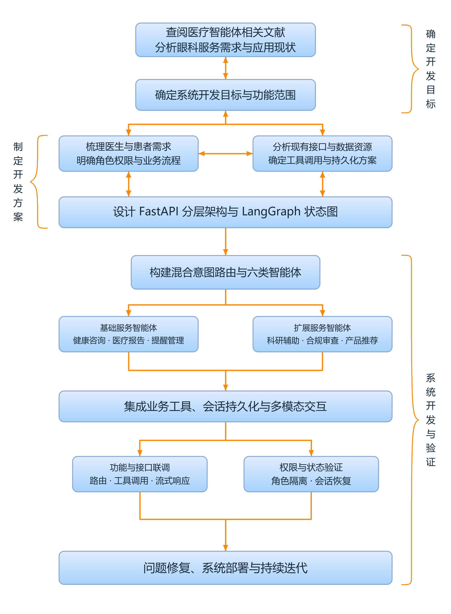

# 我们的工作

## 开发技术路线图

图：智能医疗咨询系统开发技术路线。

[下载高清 PNG（2000 × 2720，300 dpi）](assets/我们的工作-技术路线图.png) · [下载可编辑 SVG 矢量图](assets/我们的工作-技术路线图.svg)

## 开发流程介绍

本项目按照“确定开发目标—制定开发方案—系统开发与验证”的技术路线展开。首先通过文献与需求分析，明确医生和患者的业务场景、角色权限及功能范围；随后设计基于 FastAPI 与 LangGraph 的系统架构，实现混合意图路由和六类医疗智能体，并集成业务工具、会话持久化及语音附件交互。最后开展功能接口联调与权限状态验证，修复问题后完成系统部署，并根据反馈持续优化。
