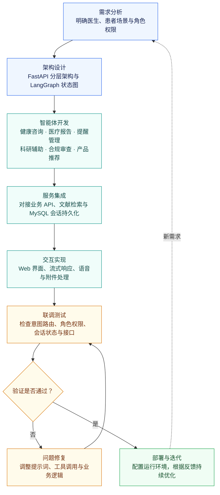

# 我们的工作

## 开发流程图

## 开发流程介绍

本项目围绕医生与患者的眼科服务需求展开开发。首先梳理业务场景和角色权限，设计基于 FastAPI 与 LangGraph 的分层多智能体架构；随后实现健康咨询、医疗报告、提醒管理、科研辅助、合规审查和产品推荐六类智能体，并接入业务接口、文献检索与会话持久化能力。在此基础上，完善 Web 交互、流式响应及语音和附件处理，通过联调检查路由、权限和会话流程，修复问题后完成部署，并根据使用反馈持续迭代。
